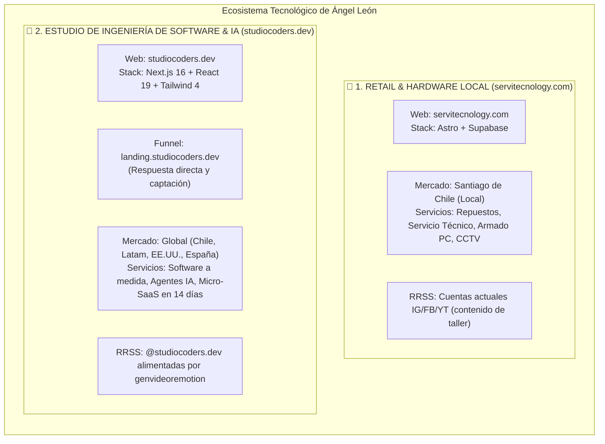

# 🗺️ Master Strategic Roadmap: Studio Coders (`studiocoders.dev`)

> **De la mezcla de servicios locales a una Agencia Boutique de Ingeniería de Software & IA de Élite.**  
> *Inspirada en el modelo de entrega en 14 días y la estética de vanguardia de Brotherhood.dev.*

---

## 1. Visión y Resumen Ejecutivo

**Studio Coders** nace para resolver la mayor fricción del mercado de desarrollo de software: las empresas y fundadores están cansados de agencias tradicionales lentas que cobran \$20,000+ USD, tardan 6 meses en entregar algo y colocan intermediarios que no entienden de código.

* **Nuestra Propuesta Central:** *"Tu software o Agente IA en producción en 14 días. No un mockup ni una demo: una primera versión real, desplegada, lista para facturar."*
* **Diferenciador:** Trato directo con desarrolladores senior, aceleración asistida por Inteligencia Artificial y arquitecturas modernas probadas en batalla.

---

## 2. La Nueva Arquitectura de Marcas: Separación Definitiva

Para no canibalizar audiencias ni diluir el *pricing power*, dividimos el ecosistema en dos entidades con propósitos específicos:



---

## 3. Lecciones Aprendidas de Whagil: Cómo Blindamos Studio Coders

A partir del diagnóstico objetivo generado por motores de IA, blindamos a Studio Coders de los 4 cuellos de botella que afectaron a Whagil:

| Error en Whagil | Solución Inmediata en Studio Coders |
| :--- | :--- |
| **Dispersión geográfica (Pago Móvil / Tasa BCV en la home).** | **Imagen B2B 100% limpia.** Moneda pública en USD, contratos internacionales y facturación comercial en Chile vía *Jesús León Soluciones Informáticas*. Cero menciones informales en la web pública. |
| **Aislamiento de Entidad (100% de menciones solo en dominios propios).** | **Construcción del Grafo de Entidades.** GitHub Organization (`studiocoders-dev`), Crunchbase, Product Hunt y LinkedIn Company Page desde la semana 1. |
| **Falta de Validación Cruzada.** | **Red de Autoría Técnica (Backlink Network).** Whagil, Whalinkbot, Infra Manager Pro y Servitecnology enlazan a Studio Coders como su equipo creador. |
| **Falta de citas en motores de IA.** | **AEO & GEO Nativo.** Schema.org JSON-LD estructurado, tablas comparativas y FAQs atómicas con respuestas declarativas. |

---

## 4. El Portafolio "Cheat Code": Nuestros Casos de Estudio

No inventamos proyectos de prueba; mostramos plataformas reales operando en producción:

1. **Whagil IA (`whagil.com`):**  
   *SaaS B2B Omnicanal de Agentes IA para Meta.* Arquitectura distribuida con WebSockets, colas de procesamiento BullMQ, Redis y orquestación de modelos LLM.
2. **Whalinkbot (`whalinkbot.com`):**  
   *Motor Cloud Asíncrono de Automatización para WhatsApp.* Infraestructura en la nube con gestión de sesiones concurrentes y tolerancia a fallos.
3. **Infra Manager Pro (`gestorinfraestructura`):**  
   *ERP Empresarial Inmobiliario & Mantenimiento.* Sistema crítico de 33,000 líneas de código con trazabilidad de cobranzas y control operativo.
4. **Servitecnology E-Commerce (`servitecnology.com`):**  
   *Plataforma de Comercio Electrónico Headless.* Catálogo de alto rendimiento en Astro + Supabase con sincronización de inventario en tiempo real.

---

## 5. El Motor de Tráfico: Factoría de Reels (`genvideoremotion`)

Utilizamos la factoría automatizada de Remotion + Gemini Flash Lite TTS + Whisper para alimentar las redes de Studio Coders con contenido faceless B2B enfocado en dolor de negocio:

* **Pilar 1 (Desmitificación):** *"Por qué las agencias tradicionales tardan 6 meses y nosotros te lo dejamos en producción en 14 días"*.
* **Pilar 2 (Casos de Automatización):** *"Cómo este negocio multiplicó sus cierres nocturnos con un Agente IA en WhatsApp"*.
* **Pilar 3 (Sistemas Propios vs Enlatados):** *"Por qué las empresas están reemplazando 5 suscripciones de software por un panel interno a medida"*.
* **Call to Action (CTA):** Comentar una palabra clave o ir al enlace de la biografía para agendar una llamada técnica de alcance de 15 minutos.

---

## 6. Fases de Ejecución

```text
FASE 1: Fundación de Identidad & Activos (Completado / En Curso)
├── [x] Creación del correo ancla: studiocoders.dev@gmail.com
├── [x] Registro del dominio studiocoders.dev (Adquirido y listo para vincular a DNS/Vercel)
├── [x] Inicialización del repositorio Next.js 16 con SDD en /home/angel/Developer/studiocoders
└── [ ] Creación de la GitHub Organization: github.com/studiocoders-dev

FASE 2: Desarrollo de la Landing Principal (Next.js 16 + Tailwind 4)
├── [x] Especificación Funcional: .agents/specs/001-foundation-landing-page.md
├── [x] Plan Técnico: .agents/plans/001-foundation-landing-page.md
├── [x] Maquetación y componentes (Hero, Proceso 14 días, Portafolio, Tabla Comparativa, FAQ, Contacto)
├── [x] Verificación de pruebas unitarias (Vitest, 15 tests pasando) y build de producción (0 errores)
└── [x] Despliegue en Vercel conectado al dominio studiocoders.dev (EN VIVO EN PRODUCCIÓN 🚀)

FASE 3: Red de Autoridad & Validación Cruzada
├── [ ] Agregar mención de autoría en footers de Whagil, Whalinkbot, Infra Manager y Servitecnology
├── [ ] Publicar perfil de empresa en LinkedIn, Crunchbase y Product Hunt
└── [ ] Inyectar Schema.org JSON-LD optimizado para Perplexity, ChatGPT y Google

FASE 4: Tracción y Escalamiento
├── [ ] Configurar plantillas de copywriter en genvideoremotion para Studio Coders
├── [ ] Lanzamiento de campaña de reels verticales en YouTube Shorts, TikTok e Instagram
└── [ ] Construcción del funnel de respuesta directa en landing.studiocoders.dev
```
