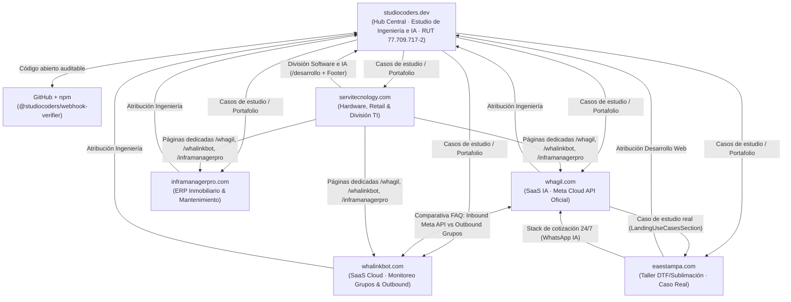

# Red de Autoridad, Validación Cruzada y Estrategia Anti-Spam SEO/AEO/GEO

> **Documento Maestro de Ingeniería de Entidad & Backlinking Semántico**  
> **Ecosistema:** `studiocoders.dev` · `whagil.com` · `whalinkbot.com` · `inframanagerpro.com` · `servitecnology.com` · `eaestampa.com`  
> **Última auditoría local de código:** Noviembre 2026  
> **Propósito:** Construir un **Grafo de Entidades (Knowledge Graph)** verificable que conecte nuestras 6 plataformas de forma orgánica y editorial —sin activar señales de granja de enlaces (*Link Scheme / SpamBrain*)— antes de ejecutar la indexación masiva en Google Search Console, Bing Webmaster Tools y directorios B2B.

---

## 1. Diagnóstico Real del Código Actual (Auditoría Local)

Al inspeccionar los 6 repositorios en esta máquina (`whatsapp-saas`, `whabot`, `gestorinfraestructura`, `landingpage`, `eastampa` y `studiocoders`), este es el mapa exacto de dónde estamos hoy:

| Dominio | Repositorio Local | Stack | Estado Actual de Cross-Linking y Schema | Brechas Detectadas (Entidad + SEO/AEO) |
| :--- | :--- | :--- | :--- | :--- |
| **`studiocoders.dev`** *(Hub Central)* | `/home/angel/Developer/studiocoders` | Next.js 16 + React 19 | Ya enlaza a las 5 plataformas (`PortfolioShowcase.tsx`), GitHub (`studiocoders-dev/webhook-verifier`) y npm (`@studiocoders/webhook-verifier`). JSON-LD `@graph` con `@id: "https://studiocoders.dev/#organization"`, `legalName: "Studio Coders Dev"` y `taxID: "77.709.717-2"`. `llms.txt` en 3/3. | **Cero enlaces entrantes** todavía desde las 5 plataformas hermanas. *(Nota opcional: en este repo figura como `Studio Coders Dev` sin la sigla `EIRL`).* |
| **`whagil.com`** | `/home/angel/Developer/whatsapp-saas` | Next.js + Supabase | Ya cita a **`eaestampa.com`** como caso de estudio real en `LandingUseCasesSection.tsx`. Declara actualmente `SERVITECNOLOGY EIRL` (`77.709.717-2`) en **13 archivos** (`layout.tsx`, `page.tsx`, `venezuela/page.tsx`, `latam/page.tsx`, `privacy`, `terms`, `refund`, `tarifas-meta`, `landing-seo.ts`, `spokes-data.ts`, `SpokeLandingTemplate.tsx`, `llms.txt`, `llms-full.txt`). | **Migrar esas 13 referencias a `Studio Coders Dev EIRL (RUT: 77.709.717-2)`**. Falta enlazar a `studiocoders.dev` y derivar a `whalinkbot.com` (FAQ + footer), agregar `creator`/`isRelatedTo` en JSON-LD y llevar `public/llms.txt` al formato estricto `llmstxt.org`. |
| **`whalinkbot.com`** | `/home/angel/Developer/whabot` | Next.js | Tiene JSON-LD `SoftwareApplication` en `src/app/layout.tsx`, `Organization` en `src/app/page.tsx` (línea 36), mención en texto plano *"desarrollada por SERVITECNOLOGY"* en `src/app/page.tsx` (línea 991) y referencias en `src/app/privacy/page.tsx` (líneas 86 y 112). | **Actualizar `SERVITECNOLOGY` a `Studio Coders Dev EIRL (RUT: 77.709.717-2)`** en JSON-LD, footer y privacidad *(manteniendo intacto `bcvService.ts` si el titular bancario Pago Móvil no cambió)*. Falta enlazar a `studiocoders.dev` y a `whagil.com` (API oficial Meta inbound) y estandarizar `public/llms.txt`. |
| **`inframanagerpro.com`** | `/home/angel/Developer/gestorinfraestructura` | Flask + Jinja2 | Tiene JSON-LD básico en `templates/landing.html` (`SoftwareApplication` sin `url` ni `creator`). | Cero mención o enlace a `studiocoders.dev` ni declaración de `Studio Coders Dev EIRL (RUT: 77.709.717-2)`. Sin `url` ni `@id` en JSON-LD, y sin archivo/ruta `/llms.txt`. |
| **`servitecnology.com`** | `/home/angel/Developer/landingpage` | Astro + Supabase | Ya cuenta con páginas dedicadas (`/whagil`, `/whalinkbot`, `/inframanagerpro`) que enlazan hacia `whagil.com`, `whalinkbot.com` e `inframanagerpro.com`. | Separar entidades: conservar `SERVITECNOLOGY EIRL` para el giro retail/hardware y facturas de repuestos, y **actualizar `Footer.astro` (línea 256), `desarrollo.astro`, fichas SaaS, `Layout.astro` y `public/llms.txt`** para atribuir la división de software e IA a **`Studio Coders Dev EIRL (RUT: 77.709.717-2)`** enlazando a `studiocoders.dev`. |
| **`eaestampa.com`** | `/home/angel/Developer/eastampa/landing-page` | Next.js | En `src/app/page.tsx` (líneas 383 y 428) **ya enlaza** hacia `https://whagil.com/vendedor-pro` (`Whagil IA`) en las FAQs, además de mencionarlo en el JSON-LD (`LocalBusiness` + `FAQPage`). | Falta enlace y atribución de desarrollo web hacia `studiocoders.dev` / **`Studio Coders Dev EIRL (RUT: 77.709.717-2)`** (footer + nodo `WebSite.creator` en JSON-LD), **corregir `"telephone": "+56912345678"`** (línea 15 de `page.tsx`), y crear `public/llms.txt`. |

> **Activos de autoridad abierta ya publicados:**  
> - GitHub: `https://github.com/studiocoders-dev/webhook-verifier` (`HTTP 200`, CI en verde).  
> - npm: `@studiocoders/webhook-verifier@1.0.0` (`https://www.npmjs.com/package/@studiocoders/webhook-verifier`).

---

## 2. Arquitectura Anti-Spam: ¿Por qué NO enlazar "Todos contra Todos"?

Si las 6 webs colocan un bloque en el *footer* diciendo *"Nuestros sitios: Whagil | Whalinkbot | InfraManagerPro | EA Estampa | Servitecnology | Studio Coders"* con enlaces recíprocos idénticos (`A ↔ B ↔ C ↔ D ↔ E ↔ F`), Google **SpamBrain** y los filtros de enlaces artificiales detectan inmediatamente una **malla circular de autopromoción (Link Ring / PBN)** y anulan o devalúan el peso de todos esos enlaces.

En cambio, el patrón que **premia Google y consumen ChatGPT/Perplexity/Gemini** es una arquitectura en **dos capas naturales**:

1. **Capa 1 — Hub-and-Spoke Semántico de Autoría (`creator` / `provider`):**
   - `studiocoders.dev` enlaza hacia las 5 plataformas como **casos de estudio reales en producción** (ya implementado en `PortfolioShowcase.tsx`).
   - Las 5 plataformas devuelven **autoría de ingeniería única** (*"Ingeniería y arquitectura por Studio Coders"* / *Powered by Studio Coders*) apuntando a `https://studiocoders.dev`, respaldada en JSON-LD con `creator: { "@id": "https://studiocoders.dev/#organization" }` y `sameAs`.
   - **Nota SEO crítica:** Un enlace de autoría en footer es estándar en la industria de software y agencias (como *"Built on Vercel"* o *"Engineered by..."*), siempre que:
     - **Varíe el *anchor text* entre sitios** (nunca el mismo texto exacto en los 5 sitios).
     - En sitios no-tech como `eaestampa.com` (estampado textil), vaya acompañado de contexto real (caso de estudio / stack técnico) o con `rel="noopener"` limpio sin sobre-optimizar palabras clave comerciales agresivas.

2. **Capa 2 — Pares de Intención Complementaria (Recomendaciones Editoriales Reales, NO recíprocas masivas):**
   - Cada plataforma recomienda **solo** a la hermana que resuelve la necesidad adyacente del usuario en ese contexto:
     - `eaestampa.com` no debe recomendar un ERP inmobiliario (`inframanagerpro.com`) — sería spam obvio. En cambio, sí es 100% natural que recomiende a **`whagil.com`** (el agente IA que cotiza sus estampados 24/7) y atribuya el desarrollo web a **`studiocoders.dev`**.
     - `whagil.com` (API Oficial Meta / Inbound / Agendamiento) y `whalinkbot.com` (Monitoreo de grupos / Outbound Cloud) sí comparten audiencia directa: es totalmente útil para el usuario enlazar entre ellas en su **FAQ / Comparativa** explicando *"¿Cuál necesito?"*.
     - `servitecnology.com` (Retail hardware y soporte TI en Chile) ya tiene páginas de producto dedicadas (`/whagil`, `/whalinkbot`, `/inframanagerpro`) y `/desarrollo`, por lo que enlaza de forma natural a **`studiocoders.dev`** como su **estudio especializado en desarrollo de software e IA**.

### Topología Visual del Grafo de Entidades



---

## 3. Matriz Maestra de Enlaces, Anchor Texts y Contexto

Para evitar huella sintética (*footprint*), **cada sitio usa un anchor text distinto** y una ubicación coherente con su audiencia:

| Sitio Origen | Sitio Destino | Ubicación Exacta en UI | Anchor Text Exacto Recomendado | Rel / Atributo | Intención Semántica (Por qué NO es spam) |
| :--- | :--- | :--- | :--- | :--- | :--- |
| **`whagil.com`** | `studiocoders.dev` | Footer (`src/app/page.tsx` + `/latam` + `/venezuela`) | `Studio Coders` *(precedido por "Arquitectura e ingeniería por")* | `rel="noopener"` (dofollow) | Atribución legítima del estudio creador (`Studio Coders Dev EIRL · RUT 77.709.717-2`). |
| **`whagil.com`** | `whalinkbot.com` | FAQ / Bloque comparativo (`landing-seo.ts`) + Footer (`src/app/page.tsx`) | `Whalinkbot` *(contexto: prospección y alertas en grupos de WhatsApp)* | `rel="noopener"` | Derivación útil: Whagil usa Meta Cloud API oficial (no lee grupos); Whalinkbot sí monitorea grupos en la nube. |
| **`whalinkbot.com`** | `studiocoders.dev` | Footer (`src/app/page.tsx`, línea 991) | `Studio Coders Dev EIRL` *(contexto: plataforma independiente diseñada en la nube por...)* | `rel="noopener"` | Reemplaza la mención plana actual de *"SERVITECNOLOGY"* por la firma de ingeniería real (`RUT 77.709.717-2`). |
| **`whalinkbot.com`** | `whagil.com` | FAQ / Descargo comparativo en `src/app/page.tsx` | `Whagil IA` *(contexto: API Oficial de Meta para WhatsApp e Instagram)* | `rel="noopener"` | Derivación útil: clientes que buscan bots conversacionales 24/7 con sello oficial Meta sin riesgo de baneo. |
| **`inframanagerpro.com`** | `studiocoders.dev` | Footer (`templates/landing.html`, líneas 466–470) | `Studio Coders Dev` *(precedido por "Ingeniería por")* | `rel="noopener"` | Único enlace saliente externo: un ERP B2B no debe enlazar a estampado textil ni bots de WhatsApp, solo a su firma de ingeniería (`RUT 77.709.717-2`). |
| **`servitecnology.com`** | `studiocoders.dev` | Página `/desarrollo` (`src/pages/desarrollo.astro`) + Footer (`src/components/Footer.astro`, línea 256) | En `/desarrollo`: `Conoce Studio Coders` · En Footer: `División de Software e IA: Studio Coders` | `rel="noopener"` | Separación comercial: `SERVITECNOLOGY EIRL` atiende hardware/soporte local en Santiago; `Studio Coders Dev EIRL` ejecuta software a medida e IA global. |
| **`servitecnology.com`** | `whagil.com`, `whalinkbot.com`, `inframanagerpro.com` | Ya existente en `/whagil`, `/whalinkbot`, `/inframanagerpro` | *(Mantener los existentes + actualizar autoría SaaS a `Studio Coders Dev EIRL` y JSON-LD `isRelatedTo`)* | `rel="noopener"` | Ya operan como páginas puente contextuales dentro de Servitecnology. |
| **`eaestampa.com`** | `whagil.com` | Ya existente en FAQs (`src/app/page.tsx`, líneas 383 y 428) + nota opcional en `#cotizar` | *(Conservar `Whagil IA` hacia `https://whagil.com/vendedor-pro`)* | `rel="noopener"` | Caso de estudio real recíproco (Whagil ya enlaza a EA Estampa como ejemplo en producción). |
| **`eaestampa.com`** | `studiocoders.dev` | Footer `.footer-bottom` (`landing-page/src/app/page.tsx`, ~línea 505) | `studiocoders.dev` *(precedido por "Web por")* | `rel="noopener"` | Atribución discreta de desarrollo web al pie de página (anchor de dominio natural y distinto al de los SaaS). |

---

## 4. Cómo Potenciar las Citaciones en IAs (AEO & GEO) con Validación Cruzada

Los LLMs con búsqueda en vivo (Perplexity, ChatGPT Search, Claude, Google AI Overviews) construyen confianza sobre una entidad cuando encuentran **triangulación verificable**:

1. **Coherencia de `@id` y Entidad Legal Creadora (`Studio Coders Dev EIRL`, `taxID: "77.709.717-2"`):**
   - `studiocoders.dev` declara `"@id": "https://studiocoders.dev/#organization"`, `"taxID": "77.709.717-2"`, y declara a `whagil.com`, `whalinkbot.com`, `inframanagerpro.com`, `servitecnology.com` y `eaestampa.com` con `creator: { "@id": "https://studiocoders.dev/#organization" }`.
   - Al agregar en **cada una de esas 5 webs** la referencia inversa dentro de su propio Schema.org declarando a **`Studio Coders Dev EIRL`** como agencia creadora:
     ```json
     "creator": {
       "@type": "Organization",
       "@id": "https://studiocoders.dev/#organization",
       "name": "Studio Coders",
       "legalName": "Studio Coders Dev EIRL",
       "taxID": "77.709.717-2",
       "url": "https://studiocoders.dev"
     }
     ```
     Google y los motores de respuesta cierran el ciclo bidireccional (*Bidirectional Entity Resolution*): ahora **Whagil, Whalinkbot, Infra Manager Pro, Servitecnology y EA Estampa confirman explícitamente en sus metadatos estructurados que fueron construidos y operados por Studio Coders Dev EIRL (`77.709.717-2`)**.

2. **Estandarización de `/llms.txt` según `llmstxt.org` (3/3 en Lighthouse 13):**
   - `studiocoders.dev/llms.txt` ya obtiene **3/3 en Navegación agéntica**.
   - Hoy `whagil.com`, `whalinkbot.com` y `servitecnology.com` tienen `llms.txt` con formato libre (y citando aún a `SERVITECNOLOGY EIRL` en el caso de Whagil), e `inframanagerpro.com` y `eaestampa.com` no tienen ninguno.
   - Estandarizar los 6 archivos `/llms.txt` con `# Título`, un único párrafo `> blockquote` (que mencione explícitamente a `Studio Coders Dev EIRL · RUT 77.709.717-2` como estudio creador cuando corresponda) y listas `- [Nombre](URL): descripción` maximiza la ingesta directa por agentes de IA y alinea los 6 dominios con Lighthouse 13.

3. **Párrafos "Answer-First" para citaciones comparativas:**
   - Cuando alguien pregunte en ChatGPT o Perplexity *"¿Qué diferencia hay entre Whagil IA y Whalinkbot?"* o *"¿Quién desarrolló Infra Manager Pro?"*, si el texto literal existe en ambos dominios con enlaces cruzados coherentes y atribución consistente a **Studio Coders Dev EIRL**, la IA cita ambos dominios en la misma respuesta.

---

## 5. Plan de Implementación Detallado por Repositorio

A continuación tienes los cambios exactos archivo por archivo para ejecutar en cada repositorio (respetando el flujo SDD donde aplique).

### 5.1 Repo `whatsapp-saas` (`whagil.com`)

**1. Migración de Razón Social Creadora/Operadora (`SERVITECNOLOGY EIRL` → `Studio Coders Dev EIRL`):**
Reemplazar todas las referencias a `SERVITECNOLOGY EIRL` como desarrolladora y operadora de Whagil IA por **`Studio Coders Dev EIRL`** (`RUT: 77.709.717-2`) en los **13 archivos** detectados en la auditoría local:
- `src/app/layout.tsx` (líneas 34–35: `authors`, `creator`)
- `src/app/page.tsx` (líneas 77–78 en `#organization` `legalName`, línea 325 en cuerpo y líneas 914–915 en footer)
- `src/app/venezuela/page.tsx` (líneas 71 y 471 + enlace footer a `studiocoders.dev`)
- `src/app/latam/page.tsx` (líneas 72 y 477 + enlace footer a `studiocoders.dev`)
- `src/app/privacy/page.tsx` (líneas 40, 43 y 276)
- `src/app/terms/page.tsx` (línea 150)
- `src/app/refund/page.tsx` (línea 92)
- `src/app/tarifas-meta/page.tsx` (línea 478)
- `src/features/landing/constants/landing-seo.ts` (líneas 8, 51 y 56)
- `src/features/landing/constants/spokes-data.ts` (líneas 77, 177, 270, 363, 456 y 555)
- `src/features/landing/components/spokes/SpokeLandingTemplate.tsx` (línea 265)
- `public/llms.txt` (línea 4 + estandarización completa)
- `public/llms-full.txt` (líneas 4 y 16)

**2. Footer en `/home/angel/Developer/whatsapp-saas/src/app/page.tsx` (líneas 905–955) y ediciones regionales (`/venezuela`, `/latam`):**
Actualizar la mención legal del pie a **`Studio Coders Dev EIRL (RUT: 77.709.717-2)`** y añadir atribución editorial al estudio y enlace al ecosistema de prospección en grupos (`whalinkbot.com`):
```tsx
<p className="text-xs text-slate-400 mt-3">
  Arquitectura e ingeniería por{' '}
  <a
    href="https://studiocoders.dev"
    target="_blank"
    rel="noopener"
    className="text-indigo-400 hover:text-indigo-300 transition-colors"
  >
    Studio Coders
  </a>{' '}
  (Studio Coders Dev EIRL · RUT: 77.709.717-2). ¿Buscas prospección y alertas en grupos de WhatsApp? Conoce{' '}
  <a
    href="https://whalinkbot.com"
    target="_blank"
    rel="noopener"
    className="text-emerald-400 hover:text-emerald-300 transition-colors"
  >
    Whalinkbot
  </a>
  .
</p>
```

**3. FAQ / Contexto Complementario (`src/features/landing/constants/landing-seo.ts`):**
Agregar una pregunta atómica en `FAQ_ITEMS` explicando la diferencia entre **Whagil IA** (Meta Cloud API oficial para conversaciones entrantes, CRM y WhatsApp + Instagram sin riesgo de baneo) y **Whalinkbot** (`https://whalinkbot.com`, monitoreo de grupos en tiempo real y prospección outbound cloud).

**4. Schema.org JSON-LD en `/home/angel/Developer/whatsapp-saas/src/app/page.tsx` (y homólogos `/venezuela`, `/latam`):**
Actualizar `legalName` a `'Studio Coders Dev EIRL'` en el nodo `#organization`, y dentro de `SoftwareApplication` (`"@id": "https://whagil.com/#software"`), añadir `creator` y `isRelatedTo`:
```ts
creator: {
  '@type': 'Organization',
  '@id': 'https://studiocoders.dev/#organization',
  name: 'Studio Coders',
  legalName: 'Studio Coders Dev EIRL',
  taxID: '77.709.717-2',
  url: 'https://studiocoders.dev',
},
isRelatedTo: [
  { '@type': 'SoftwareApplication', name: 'Whalinkbot', url: 'https://whalinkbot.com' },
],
```

**5. Actualizar `/home/angel/Developer/whatsapp-saas/public/llms.txt` al estándar estricto `llmstxt.org`:**
- Dejar `# Whagil IA`, un único bloque `>` de 1 párrafo mencionando que es una plataforma desarrollada y operada por **[Studio Coders Dev EIRL](https://studiocoders.dev) (RUT: 77.709.717-2)**, usar listas `- [Título](URL): descripción` para los planes (`/starter`, `/vendedor-pro`, `/inventario`, `/agendamiento`, `/instagram`, `/link-pro`), regiones (`/latam`, `/venezuela`), `https://whagil.com/llms-full.txt`, y una sección `## Ecosistema Relacionado`:
  - `- [Whalinkbot](https://whalinkbot.com): Plataforma complementaria en la nube para monitoreo de palabras clave en grupos de WhatsApp y prospección outbound.`
  - `- [Studio Coders](https://studiocoders.dev): Estudio de ingeniería de software e inteligencia artificial (Studio Coders Dev EIRL · RUT 77.709.717-2) creador de Whagil IA.`

---

### 5.2 Repo `whabot` (`whalinkbot.com`)

**1. Migración de Entidad Creadora/Operadora (`SERVITECNOLOGY` → `Studio Coders Dev EIRL`):**
- En `/home/angel/Developer/whabot/src/app/page.tsx`: actualizar la línea **36** (JSON-LD `"name": "Studio Coders Dev EIRL"`) y la línea **991** (Descargo de Responsabilidad).
- En `/home/angel/Developer/whabot/src/app/privacy/page.tsx`: actualizar las líneas **86** y **112** declarando a **Studio Coders Dev EIRL (`RUT: 77.709.717-2`)** como entidad operadora y responsable.
- **Precaución crítica:** NO modificar `/home/angel/Developer/whabot/src/lib/currency/bcvService.ts` (línea 161: `PAGO_MOVIL_BENEFICIARY || "SERVITECNOLOGY EIRL"`) a menos que el titular bancario real de Pago Móvil en Venezuela/banco también haya cambiado, para no afectar validaciones o instrucciones de pago vigentes.

**2. Schema.org JSON-LD en `/home/angel/Developer/whabot/src/app/layout.tsx` (líneas 71–109):**
Actualizar `orgSchema` añadiendo `@id`, `creator` y `isRelatedTo`:
```ts
const orgSchema = {
  "@context": "https://schema.org",
  "@type": "SoftwareApplication",
  "@id": "https://whalinkbot.com/#software",
  "name": "Whalinkbot",
  "applicationCategory": "BusinessApplication",
  "operatingSystem": "All (Cloud-based)",
  "url": "https://whalinkbot.com",
  "creator": {
    "@type": "Organization",
    "@id": "https://studiocoders.dev/#organization",
    "name": "Studio Coders",
    "legalName": "Studio Coders Dev EIRL",
    "taxID": "77.709.717-2",
    "url": "https://studiocoders.dev",
  },
  "isRelatedTo": [
    {
      "@type": "SoftwareApplication",
      "name": "Whagil IA",
      "url": "https://whagil.com",
      "description": "Agentes de IA conversacionales sobre la API Oficial de Meta para WhatsApp, Instagram y Messenger."
    }
  ],
  // ... conservar offers existentes ...
};
```

**3. Footer en `/home/angel/Developer/whabot/src/app/page.tsx` (línea 991):**
Reemplazar la mención plana *"desarrollada por SERVITECNOLOGY"* por enlaces semánticos reales:
```tsx
<p className="text-xs text-slate-500 max-w-2xl mx-auto leading-relaxed">
  <strong>Descargo de Responsabilidad:</strong> Whalinkbot es una plataforma independiente de software y desarrollo en la nube diseñada por{' '}
  <a
    href="https://studiocoders.dev"
    target="_blank"
    rel="noopener"
    className="text-indigo-400 hover:text-indigo-300 underline"
  >
    Studio Coders Dev EIRL
  </a>{' '}
  (RUT 77.709.717-2) bajo estricto cumplimiento de la Ley N° 21.719 de Protección de Datos de Chile. Si requieres bots conversacionales 24/7 con la API Oficial de Meta para WhatsApp e Instagram, visita{' '}
  <a
    href="https://whagil.com"
    target="_blank"
    rel="noopener"
    className="text-emerald-400 hover:text-emerald-300 underline"
  >
    Whagil IA
  </a>
  .
</p>
```

**4. Actualizar `/home/angel/Developer/whabot/public/llms.txt`:**
Convertir a formato estricto `llmstxt.org` (sin múltiples líneas `---` ni listas planas sin enlaces), citar explícitamente a **Studio Coders Dev EIRL (`RUT: 77.709.717-2`)** en el blockquote inicial y añadir sección `## Ecosistema e Ingeniería` con enlaces a `https://whagil.com` y `https://studiocoders.dev`.

---

### 5.3 Repo `gestorinfraestructura` (`inframanagerpro.com`)

**1. Schema.org JSON-LD en `/home/angel/Developer/gestorinfraestructura/templates/landing.html` (líneas 7–21):**
Enriquecer el bloque JSON-LD existente añadiendo `"url"`, `"@id"` y `"creator"` apuntando a **`Studio Coders Dev EIRL`** (`RUT: 77.709.717-2`):
```html
<script type="application/ld+json">
{
  "@context": "https://schema.org",
  "@type": "SoftwareApplication",
  "@id": "https://inframanagerpro.com/#software",
  "name": "Infra Manager Pro",
  "url": "https://inframanagerpro.com",
  "applicationCategory": "BusinessApplication",
  "operatingSystem": "Web",
  "creator": {
    "@type": "Organization",
    "@id": "https://studiocoders.dev/#organization",
    "name": "Studio Coders",
    "legalName": "Studio Coders Dev EIRL",
    "taxID": "77.709.717-2",
    "url": "https://studiocoders.dev"
  },
  "offers": {
    "@type": "Offer",
    "price": "25.00",
    "priceCurrency": "USD"
  },
  "description": "ERP empresarial de administración inmobiliaria, condominios y mantenimiento técnico crítico con trazabilidad financiera."
}
</script>
```

**2. Footer en `/home/angel/Developer/gestorinfraestructura/templates/landing.html` (líneas 466–470):**
```html
<p class="text-slate-400 text-xs mt-2 font-medium">
    Administración Técnica Rigurosa · Ingeniería por
    <a href="https://studiocoders.dev" target="_blank" rel="noopener" class="text-blue-600 hover:underline font-semibold">Studio Coders Dev</a>
    (Studio Coders Dev EIRL · RUT 77.709.717-2).<br>
    &copy; 2026 Todos los derechos reservados.
</p>
```
*(Mantener este **único** enlace externo en Infra Manager Pro para conservar la pureza B2B institucional del ERP).*

**3. Exponer `/llms.txt` en Flask (`routes/auth.py` o `app.py`):**
Agregar una ruta `@app.route('/llms.txt')` que retorne `text/plain; charset=utf-8` siguiendo estrictamente `llmstxt.org`:
```markdown
# Infra Manager Pro

> Infra Manager Pro (`https://inframanagerpro.com`) es un ERP empresarial en la nube desarrollado por Studio Coders Dev EIRL (RUT: 77.709.717-2) para la administración técnica de activos, condominios, mantenimiento crítico y cobranzas bancarias automatizadas.

## Plataforma y Capacidades

- [Infra Manager Pro](https://inframanagerpro.com): ERP inmobiliario y de gestión técnica en producción.
- [Solicitar Demo](https://inframanagerpro.com/register): Acceso de evaluación a la plataforma de gestión operativa y financiera.
- [Soporte Técnico](https://inframanagerpro.com/soporte): Canal oficial de atención para administradores y empresas.

## Ingeniería

- [Studio Coders](https://studiocoders.dev): Estudio de ingeniería de software e IA (Studio Coders Dev EIRL) creador y mantenedor de Infra Manager Pro.
```

---

### 5.4 Repo `landingpage` (`servitecnology.com`)

**0. Regla de Separación Comercial / Legal (Qué se conserva vs. qué cambia):**
- **Se MANTIENE `SERVITECNOLOGY EIRL`** para el negocio local de retail de hardware, repuestos, garantías de piezas físicas, correos transaccionales del e-commerce y cuentas de transferencia (`src/pages/terminos.astro`, `src/pages/privacidad.astro`, `src/lib/mailer.ts`, `src/pages/mis-pedidos.astro`, `src/pages/pedido/[id].astro`), salvo decisión tributaria distinta del dueño.
- **Se ACTUALIZA a `Studio Coders Dev EIRL (RUT: 77.709.717-2)` + enlaces a `https://studiocoders.dev`** en todo lo relativo a la división de desarrollo de software, IA y plataformas SaaS (`Footer.astro`, `desarrollo.astro`, `whagil.astro`, `whalinkbot.astro`, `inframanagerpro.astro`, `Layout.astro` y `public/llms.txt`).

**1. Conectar `/desarrollo` (`src/pages/desarrollo.astro`) y fichas SaaS con `https://studiocoders.dev`:**
- Servitecnology ya enlaza a `whagil.com`, `whalinkbot.com` e `inframanagerpro.com` desde `src/pages/whagil.astro`, `src/pages/whalinkbot.astro` y `src/pages/inframanagerpro.astro` (línea 50 en cada una). Añadir allí atribución clara indicando que dichos productos SaaS son desarrollados por **Studio Coders Dev EIRL (`https://studiocoders.dev`)**.
- En `src/pages/desarrollo.astro` (y en su Schema.org), añadir un CTA editorial hacia **`https://studiocoders.dev`** con anchor `Conoce Studio Coders` explicando que los proyectos corporativos de software a medida, plataformas SaaS y agentes de IA son ejecutados por **Studio Coders Dev EIRL** (división de ingeniería en Santiago con cobertura global).

**2. Footer en `/home/angel/Developer/landingpage/src/components/Footer.astro` (línea 256):**
Reemplazar la línea estática `"Diseñado y desarrollado Por SERVITECNOLOGY"` por:
```html
<p class="text-xs text-slate-500">
	División de Software e IA:
	<a
		href="https://studiocoders.dev"
		target="_blank"
		rel="noopener"
		class="text-brand-cyan hover:underline font-medium"
	>
		Studio Coders
	</a>
	(Studio Coders Dev EIRL · RUT 77.709.717-2)
</p>
```

**3. Actualizar `src/layouts/Layout.astro` + `public/llms.txt`:**
- En `src/layouts/Layout.astro`, agregar en el JSON-LD `"subOrganization"` o `"sameAs"` vinculando a `https://studiocoders.dev` (`Studio Coders Dev EIRL`).
- Reescribir `public/llms.txt` bajo el formato `llmstxt.org` (`# SERVITECNOLOGY`, 1 único párrafo `>`, listas `- [Título](URL): descripción`) incluyendo enlaces a `/repuestos`, `/whagil`, `/whalinkbot`, `/inframanagerpro` y `https://studiocoders.dev`.

---

### 5.5 Repo `eastampa` (`eaestampa.com`)

**1. Corregir dato de contacto y enriquecer Schema.org en `/home/angel/Developer/eastampa/landing-page/src/app/page.tsx`:**
- **Importante (detectado en auditoría):** reemplazar `"telephone": "+56912345678"` (línea 15) por el número comercial real de EA Estampa para evitar incoherencias NAP en Google (verificar contra el enlace de WhatsApp real de la página o confirmar con el propietario).
- Agregar un nodo `WebSite` dentro de `@graph` en `src/app/page.tsx` declarando a **Studio Coders Dev EIRL (`77.709.717-2`)** como `creator`:
```ts
{
  "@type": "WebSite",
  "@id": "https://eaestampa.com/#website",
  "url": "https://eaestampa.com",
  "name": "EA Estampa",
  "creator": {
    "@type": "Organization",
    "@id": "https://studiocoders.dev/#organization",
    "name": "Studio Coders",
    "legalName": "Studio Coders Dev EIRL",
    "taxID": "77.709.717-2",
    "url": "https://studiocoders.dev"
  }
}
```

**2. Enlaces editoriales en `/home/angel/Developer/eastampa/landing-page/src/app/page.tsx`:**
- **Conservar intactos** los dos enlaces que ya existen en las FAQs (líneas 383 y 428) apuntando a `<a href="https://whagil.com/vendedor-pro" target="_blank" rel="noopener">Whagil IA</a>` (refuerzo recíproco natural con Whagil). Opcionalmente sumar una nota discreta similar en `#cotizar`.
- En `.footer-bottom` (alrededor de la línea 505), agregar atribución discreta con el anchor único `studiocoders.dev`:
```tsx
<p>
  &copy; {new Date().getFullYear()} EA Estampa. Todos los derechos reservados. | Ideas · Diseños · Web por{" "}
  <a
    href="https://studiocoders.dev"
    target="_blank"
    rel="noopener"
    style={{ color: "inherit", textDecoration: "underline" }}
  >
    studiocoders.dev
  </a>
</p>
```

**3. Crear `/home/angel/Developer/eastampa/landing-page/public/llms.txt`:**
```markdown
# EA Estampa

> EA Estampa (`https://eaestampa.com`) es un taller especializado en estampado DTF y sublimación premium de poleras, polerones, bolsas de tela, termos y vasos cerveceros en Santiago de Chile, con atención y cotizaciones automáticas 24/7 vía WhatsApp impulsadas por Whagil IA y plataforma web diseñada por Studio Coders Dev EIRL.

## Secciones y Servicios

- [Tecnologías de Estampado](https://eaestampa.com/#tecnologias): Estampado DTF textil y sublimación de alta durabilidad desde 1 unidad.
- [Catálogo de Productos](https://eaestampa.com/#productos): Poleras, polerones, bolsas de tela, tazas y vasos cerveceros personalizados.
- [Cotizaciones 24/7](https://eaestampa.com/#cotizar): Flujo automatizado de presupuestos por WhatsApp.

## Tecnología y Desarrollo

- [Whagil IA](https://whagil.com): Motor de agentes conversacionales en WhatsApp para atención y cotización automática 24/7.
- [Studio Coders](https://studiocoders.dev): Estudio de ingeniería de software (Studio Coders Dev EIRL · RUT 77.709.717-2) responsable del desarrollo web de EA Estampa.
```

---

## 6. Orden de Ejecución y Lista de Verificación Pre-Indexación

Ejecutar en este orden estricto **antes** de enviar sitemaps a Google y Bing:

### Fase A — Cierre de la Red Cruzada Interna (en los 5 repositorios hermanos)
- [ ] **Paso 1 (`whatsapp-saas` / `whagil.com`):** Migrar los 13 archivos de `SERVITECNOLOGY EIRL` → `Studio Coders Dev EIRL (RUT: 77.709.717-2)` + actualizar footer, FAQ, JSON-LD (`creator` + `isRelatedTo`) y `public/llms.txt` (`llmstxt.org`); desplegar a producción.
- [ ] **Paso 2 (`whabot` / `whalinkbot.com`):** Migrar referencias en `page.tsx` y `privacy/page.tsx` a `Studio Coders Dev EIRL (RUT: 77.709.717-2)` + actualizar JSON-LD, footer (`studiocoders.dev` y `whagil.com`) y `public/llms.txt`; desplegar a producción.
- [ ] **Paso 3 (`landingpage` / `servitecnology.com`):** Separar hardware (`SERVITECNOLOGY EIRL`) vs. división software/IA (`Studio Coders Dev EIRL`), conectar `Footer.astro`, `/desarrollo` y fichas SaaS hacia `studiocoders.dev` + `Layout.astro` + `public/llms.txt`; desplegar a producción.
- [ ] **Paso 4 (`gestorinfraestructura` / `inframanagerpro.com`):** Actualizar JSON-LD (`creator`: `Studio Coders Dev EIRL`) y footer en `templates/landing.html` + servir `/llms.txt` desde Flask; desplegar a producción.
- [ ] **Paso 5 (`eastampa` / `eaestampa.com`):** Corregir teléfono real en JSON-LD (`+56912345678`) + agregar `WebSite.creator` (`Studio Coders Dev EIRL · 77.709.717-2`), enlace footer a `studiocoders.dev` (conservando enlaces FAQ a `whagil.com`) y crear `public/llms.txt`; desplegar a producción.

### Fase B — Validación Técnica (Antes de Indexar)
- [ ] *(Opcional en `studiocoders.dev`)* Decidir si se añade `"EIRL"` a `legalName: "Studio Coders Dev"` (`src/app/layout.tsx`, `FAQ.tsx`, `Footer.tsx`, `public/llms.txt`, `public/llms-full.txt`) para coincidencia literal 1:1 con `Studio Coders Dev EIRL`.
- [ ] Probar las 6 URLs en [Schema Markup Validator](https://validator.schema.org/) verificando 0 errores y que todas resuelvan el `@id: "https://studiocoders.dev/#organization"` con `Studio Coders Dev EIRL` (`taxID: "77.709.717-2"`).
- [ ] Confirmar respuesta `HTTP 200` en `/robots.txt`, `/sitemap.xml` y `/llms.txt` de los 6 dominios.
- [ ] Correr Lighthouse / PageSpeed sobre cada dominio tras los despliegues (objetivo `SEO 100/100` y `Navegación agéntica 3/3`).

### Fase C — Autoridad Externa (Backlinks Fuera de tu Red Propia)
El cross-linking entre tus 6 plataformas construye coherencia de entidad, pero **para que Google y los LLMs no vean solo "auto-citas"**, necesitas backlinks externos reales de terceros. Los prioritarios para `studiocoders.dev`:
- [x] **GitHub Organization (`github.com/studiocoders-dev`)** y repositorio público `webhook-verifier`.
- [x] **Registro npm (`npmjs.com/package/@studiocoders/webhook-verifier`)** con dominio verificado `contacto@studiocoders.dev`.
- [ ] **LinkedIn Company Page** para Studio Coders Dev EIRL enlazando a `https://studiocoders.dev` (agregar ese URL en `sameAs` del JSON-LD de `studiocoders.dev` una vez creada).
- [ ] **Crunchbase / Product Hunt / Clutch / Sortlist** (perfiles gratuitos de agencia de software apuntando a `https://studiocoders.dev` y a los productos `whagil.com` / `whalinkbot.com`).
- [ ] **GitHub READMEs / Perfiles:** Asegurar que todos los repositorios públicos de la org apunten a `https://studiocoders.dev`.

### Fase D — Indexación Oficial en Buscadores
Una vez completadas las Fases A y B (para que Googlebot y Bingbot rastreen el grafo ya conectado desde el primer crawl):
1. **Google Search Console (`search.google.com/search-console`):**
   - Verificar propiedad de dominio por DNS en Cloudflare (un registro `TXT` por dominio).
   - Enviar `https://www.studiocoders.dev/sitemap.xml` (y el `sitemap.xml` de los otros 5 dominios).
   - Solicitar **Indexación manual** (`Inspect any URL -> Request Indexing`) de las URLs principales.
2. **Bing Webmaster Tools (`bing.com/webmasters`):**
   - Importar desde Google Search Console o verificar por DNS en Cloudflare.
   - Enviar sitemaps y verificar **IndexNow** *(clave crítica: **ChatGPT Search y Copilot usan el índice de Bing**, por lo que estar indexado y limpio en Bing impacta directamente en las citaciones de ChatGPT)*.

---

## 7. Prompts SDD Listos para Ejecutar en Cada Proyecto

Copia y pega el bloque correspondiente dentro de la sesión de Antigravity/IA abierta en **cada repositorio individual**. Cada prompt exige trabajar bajo **Spec-Driven Development (SDD)**: primero redactar la **Spec** y el **Plan Técnico**, detenerse a esperar tu aprobación humana (**Gate 3**), y luego ejecutar y validar (**Gate 4**) antes del despliegue.

### 7.1 Prompt para `whatsapp-saas` (`whagil.com`)

```text
Trabajaremos bajo Spec-Driven Development (SDD) en este repositorio (whatsapp-saas / whagil.com).
ANTES de editar una sola línea de código en src/ o public/, debes:
1. Revisar los archivos indicados abajo para confirmar su estado exacto actual.
2. Crear la Spec en .agents/specs/ (si no existe la carpeta .agents/specs/, créala) con requisitos EARS y Definition of Done (DoD), y crear el Plan Técnico en .agents/plans/ detallando archivo por archivo qué cambiarás y cómo verificarás.
3. DETENERTE en Gate 3 y pedirme aprobación explícita antes de escribir o modificar código en src/ o public/.

OBJETIVO DE LA TAREA:
1) Migración de Entidad Creadora y Operadora Legal:
   Reemplazar las referencias a "SERVITECNOLOGY EIRL" como empresa creadora/operadora de Whagil IA por "Studio Coders Dev EIRL" (manteniendo el mismo RUT: 77.709.717-2) en los 13 archivos detectados:
   - src/app/layout.tsx (líneas 34-35: authors y creator)
   - src/app/page.tsx (líneas 77-78 legalName en #organization, línea 325 cuerpo y líneas 914-915 footer)
   - src/app/venezuela/page.tsx (líneas 71 y 471)
   - src/app/latam/page.tsx (líneas 72 y 477)
   - src/app/privacy/page.tsx (líneas 40, 43 y 276)
   - src/app/terms/page.tsx (línea 150)
   - src/app/refund/page.tsx (línea 92)
   - src/app/tarifas-meta/page.tsx (línea 478)
   - src/features/landing/constants/landing-seo.ts (líneas 8, 51 y 56)
   - src/features/landing/constants/spokes-data.ts (líneas 77, 177, 270, 363, 456 y 555)
   - src/features/landing/components/spokes/SpokeLandingTemplate.tsx (línea 265)
   - public/llms.txt (línea 4)
   - public/llms-full.txt (líneas 4 y 16)
   (Verifica también con grep si existen ocurrencias adicionales de "SERVITECNOLOGY" antes de planificar).

2) Cross-Linking Anti-Spam (SEO/AEO/GEO):
   - En los footers de src/app/page.tsx (y verificar /venezuela y /latam), añadir atribución editorial con rel="noopener" hacia https://studiocoders.dev usando exactamente el anchor text "Studio Coders" (precedido de "Arquitectura e ingeniería por" y aclarando "(Studio Coders Dev EIRL · RUT: 77.709.717-2)"), más un enlace complementario con rel="noopener" hacia https://whalinkbot.com usando el anchor text "Whalinkbot" para quienes buscan monitoreo y prospección en grupos de WhatsApp.
   - NO crear un anillo de enlaces a todos los demás dominios. Conservar el caso de estudio existente hacia eaestampa.com en LandingUseCasesSection.tsx.
   - En src/features/landing/constants/landing-seo.ts (FAQ_ITEMS), añadir una pregunta "Answer-First" explicando la diferencia entre Whagil IA (Meta Cloud API oficial inbound sin riesgo de baneo) y Whalinkbot (monitoreo de grupos en la nube y outbound).

3) Schema.org JSON-LD Bidireccional:
   - En src/app/page.tsx (y replicar coherencia en /venezuela y /latam si tienen @graph): actualizar legalName a "Studio Coders Dev EIRL" en #organization, y en SoftwareApplication ("@id": "https://whagil.com/#software") añadir:
     * creator: { "@type": "Organization", "@id": "https://studiocoders.dev/#organization", "name": "Studio Coders", "legalName": "Studio Coders Dev EIRL", "taxID": "77.709.717-2", "url": "https://studiocoders.dev" }
     * isRelatedTo: [{ "@type": "SoftwareApplication", "name": "Whalinkbot", "url": "https://whalinkbot.com" }]

4) Estandarización de public/llms.txt (llmstxt.org):
   - Reescribir public/llms.txt siguiendo estrictamente la especificación llmstxt.org: H1 (# Whagil IA), UN solo párrafo blockquote (> ...) mencionando que es desarrollada y operada por Studio Coders Dev EIRL (RUT: 77.709.717-2, https://studiocoders.dev), listas Markdown "- [Título](URL): descripción" para planes, regiones, llms-full.txt y una sección "## Ecosistema Relacionado" enlazando a Whalinkbot y Studio Coders.

5) Gate 4 (al ejecutar tras mi aprobación):
   - Correr tests unitarios, verificación de tipos (tsc --noEmit), lint y build de producción sin errores.

Por ahora solo inspecciona el repo, redacta la Spec y el Plan Técnico, y preséntamelos esperando mi "aprobado".
```

---

### 7.2 Prompt para `whabot` (`whalinkbot.com`)

```text
Trabajaremos bajo Spec-Driven Development (SDD) en este repositorio (whabot / whalinkbot.com).
ANTES de editar una sola línea de código en src/ o public/, debes:
1. Revisar los archivos listados abajo para verificar su estado actual.
2. Crear la Spec en .agents/specs/ (si no existe la carpeta, créala) con requisitos EARS y DoD, y crear el Plan Técnico en .agents/plans/ detallando archivos a tocar y verificaciones.
3. DETENERTE en Gate 3 y pedirme aprobación explícita antes de modificar código.

OBJETIVO DE LA TAREA:
1) Migración de Entidad Creadora/Operadora a Studio Coders Dev EIRL (RUT: 77.709.717-2):
   - Actualizar "SERVITECNOLOGY" -> "Studio Coders Dev EIRL" en:
     * src/app/page.tsx (línea 36 en el JSON-LD y línea 991 en el Descargo de Responsabilidad del footer)
     * src/app/privacy/page.tsx (líneas 86 y 112)
   - PRECAUCIÓN CRÍTICA: NO modificar src/lib/currency/bcvService.ts (línea 161: PAGO_MOVIL_BENEFICIARY || "SERVITECNOLOGY EIRL") sin confirmarlo conmigo explícitamente, ya que corresponde al titular bancario de cobros Pago Móvil.
   - Verifica con grep si existen otras menciones a SERVITECNOLOGY en src/ o public/.

2) Cross-Linking Anti-Spam (SEO/AEO/GEO):
   - En src/app/page.tsx (línea 991, Descargo de Responsabilidad del footer): reemplazar el texto plano actual por enlaces con rel="noopener":
     * Enlace a https://studiocoders.dev con el anchor text exacto "Studio Coders Dev EIRL" seguido de "(RUT 77.709.717-2)".
     * Enlace complementario en el mismo descargo (o en una FAQ comparativa de la landing) hacia https://whagil.com con el anchor text exacto "Whagil IA" para usuarios que busquen bots conversacionales 24/7 con la API Oficial de Meta para WhatsApp e Instagram.
   - No agregar enlaces en el footer hacia los demás sitios del grupo.

3) Schema.org JSON-LD Bidireccional en src/app/layout.tsx (líneas 71-109):
   - Enriquecer orgSchema (SoftwareApplication) con:
     * "@id": "https://whalinkbot.com/#software"
     * "url": "https://whalinkbot.com"
     * "creator": { "@type": "Organization", "@id": "https://studiocoders.dev/#organization", "name": "Studio Coders", "legalName": "Studio Coders Dev EIRL", "taxID": "77.709.717-2", "url": "https://studiocoders.dev" }
     * "isRelatedTo": [{ "@type": "SoftwareApplication", "name": "Whagil IA", "url": "https://whagil.com", "description": "Agentes de IA conversacionales sobre la API Oficial de Meta para WhatsApp, Instagram y Messenger." }]
   - Conservar las ofertas y campos válidos existentes, y asegurarte de que src/app/page.tsx línea 36 sea coherente con esto y no genere organizaciones duplicadas contradictorias.

4) Estandarización de public/llms.txt (llmstxt.org):
   - Reescribir public/llms.txt eliminando divisores "---" y viñetas planas sin URL; usar H1 (# Whalinkbot), un único párrafo blockquote (> ...) indicando que es desarrollado por Studio Coders Dev EIRL (RUT: 77.709.717-2, https://studiocoders.dev), listas Markdown "- [Título](URL): descripción" para funcionalidades y planes, y una sección "## Ecosistema e Ingeniería" con enlaces a Whagil IA (https://whagil.com) y Studio Coders (https://studiocoders.dev).

5) Gate 4 (al ejecutar tras mi aprobación):
   - Ejecutar verificación de tipos, tests (si existen), lint y build de Next.js sin errores.

Por ahora solo analiza el código, crea la Spec y el Plan Técnico, y espera mi aprobación en Gate 3.
```

---

### 7.3 Prompt para `gestorinfraestructura` (`inframanagerpro.com`)

```text
Trabajaremos bajo Spec-Driven Development (SDD) en este repositorio (gestorinfraestructura / inframanagerpro.com, stack Flask + Jinja2).
ANTES de editar cualquier plantilla o ruta Python, debes:
1. Inspeccionar templates/landing.html, templates/base.html y routes/auth.py (o app.py) para confirmar cómo se renderiza la landing y las rutas públicas.
2. Crear la Spec en .agents/specs/ (si no existe el directorio, créalo) con requisitos EARS y DoD, y crear el Plan Técnico en .agents/plans/.
3. DETENERTE en Gate 3 y esperar mi aprobación explícita antes de aplicar cambios.

OBJETIVO DE LA TAREA:
1) Pureza B2B Anti-Spam (Único Enlace Saliente):
   - Infra Manager Pro es un ERP B2B inmobiliario y de mantenimiento técnico. NO debe enlazar a herramientas de WhatsApp, bots ni talleres de estampado.
   - Su único enlace externo saliente debe apuntar a su firma de ingeniería creadora: https://studiocoders.dev.

2) Footer en templates/landing.html (alrededor de las líneas 466-470):
   - Actualizar el footer añadiendo la atribución técnica: "Ingeniería por" seguido de un enlace con rel="noopener" y target="_blank" hacia https://studiocoders.dev con el anchor text exacto "Studio Coders Dev", acompañado de "(Studio Coders Dev EIRL · RUT 77.709.717-2)".

3) Schema.org JSON-LD Bidireccional en templates/landing.html (líneas 7-21):
   - Mantener los datos reales de SoftwareApplication (price, currency, description) y agregar:
     * "@id": "https://inframanagerpro.com/#software"
     * "url": "https://inframanagerpro.com"
     * "creator": { "@type": "Organization", "@id": "https://studiocoders.dev/#organization", "name": "Studio Coders", "legalName": "Studio Coders Dev EIRL", "taxID": "77.709.717-2", "url": "https://studiocoders.dev" }

4) Exponer /llms.txt desde Flask (routes/auth.py o app.py):
   - Crear la ruta GET /llms.txt sirviendo text/plain; charset=utf-8 bajo formato estricto llmstxt.org:
     * H1: # Infra Manager Pro
     * Un único párrafo blockquote (> ...) describiendo el ERP desarrollado por Studio Coders Dev EIRL (RUT: 77.709.717-2).
     * Secciones con listas "- [Título](URL): descripción" hacia las rutas públicas (/register, /soporte, etc.) y una sección "## Ingeniería" enlazando a Studio Coders (https://studiocoders.dev).
   - Si existe sitemap o robots.txt en Flask, asegurarse de que /llms.txt no quede bloqueado.

5) Gate 4 (al ejecutar tras mi aprobación):
   - Correr pytest / suite de pruebas de Flask o validación de sintaxis Python, renderizado HTML del template landing.html y respuesta HTTP 200 de /llms.txt.

Por ahora solo inspecciona el repo, redacta la Spec y el Plan Técnico, y preséntamelos esperando mi "aprobado".
```

---

### 7.4 Prompt para `landingpage` (`servitecnology.com`)

```text
Trabajaremos bajo Spec-Driven Development (SDD) en este repositorio (landingpage / servitecnology.com, stack Astro + Supabase).
ANTES de editar cualquier archivo en src/ o public/, debes:
1. Revisar los archivos indicados abajo para verificar su estado actual.
2. Crear la Spec en .agents/specs/ (si no existe la carpeta, créala) con requisitos EARS y DoD, y el Plan Técnico en .agents/plans/.
3. DETENERTE en Gate 3 esperando mi aprobación explícita antes de tocar código.

REGLA CRÍTICA DE SEPARACIÓN DE ENTIDADES (NO ROMPER EL E-COMMERCE):
- MANTENER "SERVITECNOLOGY EIRL" intacto para el giro de retail de hardware, repuestos, garantías físicas, correos transaccionales del e-commerce y transferencia bancaria (src/pages/terminos.astro, src/pages/privacidad.astro, src/lib/mailer.ts, src/pages/mis-pedidos.astro, src/pages/pedido/[id].astro).
- ACTUALIZAR a "Studio Coders Dev EIRL (RUT: 77.709.717-2)" + enlaces hacia https://studiocoders.dev únicamente en lo relacionado con la división de desarrollo de software, IA y plataformas SaaS.

OBJETIVO DE LA TAREA:
1) Footer (src/components/Footer.astro, alrededor de la línea 256):
   - Reemplazar la línea estática "Diseñado y desarrollado Por SERVITECNOLOGY" por un bloque que indique: "División de Software e IA:" con enlace a https://studiocoders.dev (rel="noopener", target="_blank", anchor text "Studio Coders") y aclaración "(Studio Coders Dev EIRL · RUT 77.709.717-2)".

2) Conectar /desarrollo y fichas SaaS con Studio Coders Dev EIRL:
   - En src/pages/desarrollo.astro: añadir un CTA secundario editorial hacia https://studiocoders.dev con el anchor text "Conoce Studio Coders", explicando que los proyectos corporativos de software a medida, SaaS y agentes de IA son ejecutados por Studio Coders Dev EIRL (nuestra división especializada de ingeniería de software).
   - En src/pages/whagil.astro, src/pages/whalinkbot.astro y src/pages/inframanagerpro.astro (donde ya existen botones hacia los sitios externos): revisar y asegurar que la autoría de ingeniería de esas plataformas cite a Studio Coders Dev EIRL (https://studiocoders.dev) y que no falte rel="noopener" en sus enlaces externos.

3) Schema.org JSON-LD en src/layouts/Layout.astro (y en desarrollo.astro si aplica):
   - Agregar vínculo semántico ("subOrganization" o "sameAs") apuntando a { "@type": "Organization", "@id": "https://studiocoders.dev/#organization", "name": "Studio Coders", "legalName": "Studio Coders Dev EIRL", "taxID": "77.709.717-2", "url": "https://studiocoders.dev" }.

4) Estandarización de public/llms.txt (llmstxt.org):
   - Reescribir public/llms.txt sustituyendo el formato de texto numerado plano por el estándar llmstxt.org: H1 (# SERVITECNOLOGY), un único párrafo blockquote (> ...), y listas Markdown "- [Título](URL): descripción" incluyendo /repuestos, /desarrollo, /whagil, /whalinkbot, /inframanagerpro y enlace a nuestra división de ingeniería Studio Coders (https://studiocoders.dev).

5) Gate 4 (al ejecutar tras mi aprobación):
   - Ejecutar astro check / typecheck / npm run build sin errores.

Por ahora solo analiza los archivos, crea la Spec y el Plan Técnico, y detente en Gate 3 esperando mi aprobación.
```

---

### 7.5 Prompt para `eastampa` (`eaestampa.com`)

```text
Trabajaremos bajo Spec-Driven Development (SDD) en este repositorio (eastampa/landing-page / eaestampa.com, stack Next.js).
ANTES de editar cualquier archivo en src/ o public/, debes:
1. Inspeccionar landing-page/src/app/page.tsx, landing-page/src/app/layout.tsx y landing-page/public/ para verificar el estado actual.
2. Crear la Spec en .agents/specs/ (si no existe, créala en landing-page/.agents/ o en la raíz según la estructura del repo) con requisitos EARS y DoD, y el Plan Técnico en .agents/plans/.
3. DETENERTE en Gate 3 y esperar mi aprobación explícita antes de modificar código.

OBJETIVO DE LA TAREA:
1) Corregir Dato de Contacto Placeholder en JSON-LD (NAP Consistency):
   - En landing-page/src/app/page.tsx (línea 15), existe "telephone": "+56912345678" en el JSON-LD LocalBusiness. Revisa el botón real de WhatsApp en el mismo page.tsx para obtener el teléfono comercial real de EA Estampa (o pregúntamelo antes de ejecutar en Gate 3 si no está visible en el archivo) y reemplaza ese placeholder.

2) Schema.org JSON-LD Bidireccional (WebSite + creator):
   - En landing-page/src/app/page.tsx dentro del @graph existente (sin romper LocalBusiness ni FAQPage), añadir el nodo WebSite:
     * "@type": "WebSite"
     * "@id": "https://eaestampa.com/#website"
     * "url": "https://eaestampa.com"
     * "name": "EA Estampa"
     * "creator": { "@type": "Organization", "@id": "https://studiocoders.dev/#organization", "name": "Studio Coders", "legalName": "Studio Coders Dev EIRL", "taxID": "77.709.717-2", "url": "https://studiocoders.dev" }

3) Enlaces Editoriales y Footer Anti-Spam:
   - CONSERVAR intactos los dos enlaces existentes en las FAQs de page.tsx (líneas 383 y 428) que ya apuntan a https://whagil.com/vendedor-pro con el texto "Whagil IA". Opcionalmente añadir una mención sutil en la sección #cotizar.
   - NO enlazar a whalinkbot.com, inframanagerpro.com ni servitecnology.com (no tienen relación con estampado textil y parecería spam).
   - En .footer-bottom de landing-page/src/app/page.tsx (alrededor de la línea 505), añadir atribución discreta de desarrollo web con rel="noopener" y target="_blank" hacia https://studiocoders.dev usando el anchor text exacto "studiocoders.dev" (ej: "| Ideas · Diseños · Web por studiocoders.dev").

4) Crear landing-page/public/llms.txt (estándar llmstxt.org):
   - Crear public/llms.txt con:
     * H1: # EA Estampa
     * Un único párrafo blockquote (> ...) describiendo los servicios de estampado DTF y sublimación en Santiago de Chile, cotizaciones 24/7 con Whagil IA y desarrollo web por Studio Coders Dev EIRL.
     * Listas Markdown "- [Título](URL): descripción" hacia las secciones (#tecnologias, #productos, #cotizar) y una sección "## Tecnología y Desarrollo" enlazando a Whagil IA (https://whagil.com) y Studio Coders (https://studiocoders.dev).

5) Gate 4 (al ejecutar tras mi aprobación):
   - Ejecutar verificación de tipos (tsc --noEmit), lint y npm run build dentro de landing-page/ sin errores.

Por ahora solo inspecciona el repo, redacta la Spec y el Plan Técnico, confirma si pudiste extraer el teléfono real de EA Estampa desde page.tsx, y espera mi aprobación en Gate 3.
```
