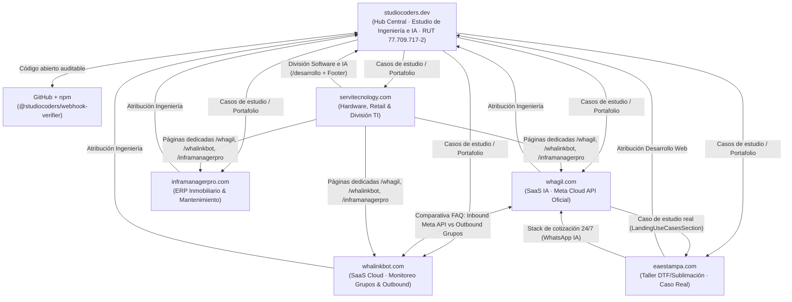

# Red de Autoridad, Validación Cruzada y Estrategia Anti-Spam SEO/AEO/GEO

> **Documento Maestro de Ingeniería de Entidad & Backlinking Semántico**  
> **Ecosistema:** `studiocoders.dev` · `whagil.com` · `whalinkbot.com` · `inframanagerpro.com` · `servitecnology.com` · `eaestampa.com`  
> **Última auditoría local de código:** Noviembre 2026  
> **Propósito:** Construir un **Grafo de Entidades (Knowledge Graph)** verificable que conecte nuestras 6 plataformas de forma orgánica y editorial —sin activar señales de granja de enlaces (*Link Scheme / SpamBrain*)— antes de ejecutar la indexación masiva en Google Search Console, Bing Webmaster Tools y directorios B2B.

---

## 1. Diagnóstico Real del Código Actual (Auditoría Local)

Al inspeccionar los 6 repositorios en esta máquina (`whatsapp-saas`, `whabot`, `gestorinfraestructura`, `landingpage`, `eastampa` y `studiocoders`), este es el mapa exacto de dónde estamos hoy:

| Dominio | Repositorio Local | Stack | Estado Actual de Cross-Linking y Schema | Brechas Detectadas (Entidad Legal SII/Meta + SEO/AEO) |
| :--- | :--- | :--- | :--- | :--- |
| **`studiocoders.dev`** *(Hub Central)* | `/home/angel/Developer/studiocoders` | Next.js 16 + React 19 | Ya enlaza a las 5 plataformas (`PortfolioShowcase.tsx`), GitHub (`studiocoders-dev/webhook-verifier`) y npm (`@studiocoders/webhook-verifier`). JSON-LD `@graph` con `@id: "https://studiocoders.dev/#organization"`, `name: "Studio Coders"`, `legalName: "Studio Coders Dev"` y `taxID: "77.709.717-2"`. `llms.txt` en 3/3. **100% alineado con `.agents/rules/business-positioning.md` y `tests/seo-geo-aeo.test.ts` (no requiere cambios en `src/` ni `public/`).** | **Cero enlaces entrantes** todavía desde las 5 plataformas hermanas. |
| **`whagil.com`** | `/home/angel/Developer/whatsapp-saas` | Next.js + Supabase | Ya cita a **`eaestampa.com`** como caso de estudio real en `LandingUseCasesSection.tsx`. Declara actualmente el nombre inexacto `SERVITECNOLOGY EIRL` (`77.709.717-2`) en **13 archivos**, mientras que `docs/compliance/` y `fase-41-guia-completa.md` declaran la EIRL real registrada ante Meta y SII. | **Separar marca y razón social:** usar **`Studio Coders`** (`studiocoders.dev`) en marketing/ingeniería y **`JESUS LEON SOLUCIONES INFORMÁTICAS E.I.R.L. (RUT: 77.709.717-2)`** en textos legales, privacidad, términos, facturación SII y `legalName` JSON-LD (para no romper Meta Business Verification). Añadir enlaces a `studiocoders.dev` y `whalinkbot.com` + estandarizar `public/llms.txt`. |
| **`whalinkbot.com`** | `/home/angel/Developer/whabot` | Next.js | Tiene JSON-LD `SoftwareApplication` en `src/app/layout.tsx`, `Organization` en `src/app/page.tsx` (línea 36), mención plana *"desarrollada por SERVITECNOLOGY"* en `src/app/page.tsx` (línea 991) y referencias en `src/app/privacy/page.tsx` (líneas 86 y 112). | Declarar **`Studio Coders Dev`** (`https://studiocoders.dev`) como estudio de desarrollo bajo la razón social **`JESUS LEON SOLUCIONES INFORMÁTICAS E.I.R.L. (RUT: 77.709.717-2)`** en JSON-LD, footer y privacidad *(manteniendo `bcvService.ts` sin cambios salvo confirmación bancaria)*. Añadir enlaces a `studiocoders.dev` y `whagil.com` + estandarizar `public/llms.txt`. |
| **`inframanagerpro.com`** | `/home/angel/Developer/gestorinfraestructura` | Flask + Jinja2 | Tiene JSON-LD básico en `templates/landing.html` (`SoftwareApplication` sin `url` ni `creator`). | Cero mención o enlace a `studiocoders.dev`. Agregar `creator` en JSON-LD (`name: "Studio Coders"`, `legalName: "JESUS LEON SOLUCIONES INFORMÁTICAS E.I.R.L."`, `taxID: "77.709.717-2"`), enlace único en footer y ruta `/llms.txt`. |
| **`servitecnology.com`** | `/home/angel/Developer/landingpage` | Astro + Supabase | Ya cuenta con páginas dedicadas (`/whagil`, `/whalinkbot`, `/inframanagerpro`) que enlazan hacia `whagil.com`, `whalinkbot.com` e `inframanagerpro.com`. Usa `"SERVITECNOLOGY EIRL"` en legales, mailer y fichas de pedido. | Corregir `"SERVITECNOLOGY EIRL"` declarando **`SERVITECNOLOGY`** como marca comercial de **`JESUS LEON SOLUCIONES INFORMÁTICAS E.I.R.L. (RUT: 77.709.717-2)`** para hardware/e-commerce *(verificando titular BancoEstado antes de tocar `pedido/[id].astro`)*, y atribuir la división de software e IA (`Footer.astro`, `/desarrollo`, fichas SaaS, `Layout.astro`, `llms.txt`) a **`Studio Coders`** (`studiocoders.dev`). |
| **`eaestampa.com`** | `/home/angel/Developer/eastampa/landing-page` | Next.js | En `src/app/page.tsx` (líneas 383 y 428) **ya enlaza** hacia `https://whagil.com/vendedor-pro` (`Whagil IA`) en las FAQs, además de mencionarlo en el JSON-LD (`LocalBusiness` + `FAQPage`). | Corregir `"telephone": "+56912345678"` (línea 15), añadir nodo `WebSite.creator` en JSON-LD con `@id: "https://studiocoders.dev/#organization"` + `legalName: "JESUS LEON SOLUCIONES INFORMÁTICAS E.I.R.L."`, añadir atribución limpia en footer (`Web por studiocoders.dev`, sin exponer EIRL/RUT ajeno al cliente) y crear `public/llms.txt`. |

> **Activos de autoridad abierta ya publicados:**  
> - GitHub: `https://github.com/studiocoders-dev/webhook-verifier` (`HTTP 200`, CI en verde).  
> - npm: `@studiocoders/webhook-verifier@1.0.0` (`https://www.npmjs.com/package/@studiocoders/webhook-verifier`).

### 1.1 Blindaje Legal Meta Tech Provider + SII + Schema.org (Regla Maestra)

En Chile (Ley N° 19.857 y Servicio de Impuestos Internos), la sigla **`E.I.R.L.`** solo puede acompañar a la razón social inscrita en el estatuto y el **e-RUT oficial**:

- **Razón Social Legal / Tributaria (SII & Meta Business Verification):** **`JESUS LEON SOLUCIONES INFORMÁTICAS E.I.R.L.`** (`RUT: 77.709.717-2`)
- **Marcas Comerciales / Nombres de Fantasía:** **`Studio Coders`** / **`Studio Coders Dev`** (estudio de ingeniería e IA), **`Whagil IA`**, **`Whalinkbot`**, **`Infra Manager Pro`**, **`SERVITECNOLOGY`** (retail hardware).

> ⚠️ **Por qué está PROHIBIDO escribir `"Studio Coders Dev EIRL"` o `"SERVITECNOLOGY EIRL"` en legales, privacidad o JSON-LD:**
> 1. **Meta Tech Provider (`business.facebook.com`):** Meta verifica tu portafolio contra el e-RUT del SII (`JESUS LEON SOLUCIONES INFORMÁTICAS E.I.R.L.`). Si `/privacy`, `/terms` o el aviso legal del footer en `whagil.com` muestran `"Studio Coders Dev EIRL"` (o `"SERVITECNOLOGY EIRL"`), en el próximo **Data Use Checkup** anual o **App Review** se produce un *Legal Entity Mismatch*; y cambiar el nombre legal en Business Info sin reforma previa ante el SII dispara una re-verificación que puede dejar el portafolio temporalmente en *Unverified / Pending*. *(Nota: el campo `Nombre · Opcional` en `developers.facebook.com` corresponde solo al contacto DPO de GDPR en la UE, no a la verificación de empresa).*
> 2. **SII, Facturación y Bancos:** Las facturas emitidas vía Webpay/Mercado Pago con el `RUT 77.709.717-2` salen a nombre de `JESUS LEON SOLUCIONES INFORMÁTICAS E.I.R.L.`.
> 3. **Compliance (`docs/compliance/`):** Los documentos vigentes de Ley N° 21.719 (Protección de Datos) y Ley N° 21.595 respaldan esa misma persona jurídica (`RUT 77.709.717-2`). Dado que `"Y CONSUMIBLES"` **ya fue eliminado en las escrituras actualizadas y en el e-RUT del SII**, la razón social oficial única es **`JESUS LEON SOLUCIONES INFORMÁTICAS E.I.R.L.`** y se debe limpiar toda ocurrencia heredada con `"Y CONSUMIBLES"` en `whatsapp-saas/docs/compliance/` y `docs/arquitectura/fase-41-guia-completa.md`.

**Fórmula de convivencia sin fricción en las 6 webs:**
1. **Textos comerciales, Hero, Spokes y `llms.txt`:** Usar **`Studio Coders`** (`https://studiocoders.dev`) sin sigla `EIRL`.
2. **Footers legales, `/privacy`, `/terms`, `/refund` y facturación SII:** Declarar **`Studio Coders (marca comercial de JESUS LEON SOLUCIONES INFORMÁTICAS E.I.R.L. · RUT: 77.709.717-2)`**.
3. **Schema.org JSON-LD:** Separar `name` / `alternateName` (marca SEO) de `legalName` (razón social exacta SII/Meta).
4. **En web de cliente externo (`eaestampa.com`):** Dejar el footer visible solo como `Web por studiocoders.dev` y declarar el `legalName` dentro del JSON-LD `WebSite.creator`.

---

## 2. Arquitectura Anti-Spam: ¿Por qué NO enlazar "Todos contra Todos"?

Si las 6 webs colocan un bloque en el *footer* diciendo *"Nuestros sitios: Whagil | Whalinkbot | InfraManagerPro | EA Estampa | Servitecnology | Studio Coders"* con enlaces recíprocos idénticos (`A ↔ B ↔ C ↔ D ↔ E ↔ F`), Google **SpamBrain** y los filtros de enlaces artificiales detectan inmediatamente una **malla circular de autopromoción (Link Ring / PBN)** y anulan o devalúan el peso de todos esos enlaces.

En cambio, el patrón que **premia Google y consumen ChatGPT/Perplexity/Gemini** es una arquitectura en **dos capas naturales**:

1. **Capa 1 — Hub-and-Spoke Semántico de Autoría (`creator` / `provider`):**
   - `studiocoders.dev` enlaza hacia las 5 plataformas como **casos de estudio reales en producción** (ya implementado en `PortfolioShowcase.tsx`).
   - Las 5 plataformas devuelven **autoría de ingeniería única** (*"Ingeniería y arquitectura por Studio Coders"* / *Powered by Studio Coders*) apuntando a `https://studiocoders.dev`, respaldada en JSON-LD con `creator: { "@id": "https://studiocoders.dev/#organization" }` y `sameAs`.
   - **Nota SEO crítica:** Un enlace de autoría en footer es estándar en la industria de software y agencias (como *"Built on Vercel"* o *"Engineered by..."*), siempre que:
     - **Varíe el *anchor text* entre sitios** (nunca el mismo texto exacto en los 5 sitios).
     - En sitios no-tech como `eaestampa.com` (estampado textil), vaya acompañado de contexto real (caso de estudio / stack técnico) o con `rel="noopener"` limpio sin sobre-optimizar palabras clave comerciales agresivas.

2. **Capa 2 — Pares de Intención Complementaria (Recomendaciones Editoriales Reales, NO recíprocas masivas):**
   - Cada plataforma recomienda **solo** a la hermana que resuelve la necesidad adyacente del usuario en ese contexto:
     - `eaestampa.com` no debe recomendar un ERP inmobiliario (`inframanagerpro.com`) — sería spam obvio. En cambio, sí es 100% natural que recomiende a **`whagil.com`** (el agente IA que cotiza sus estampados 24/7) y atribuya el desarrollo web a **`studiocoders.dev`**.
     - `whagil.com` (API Oficial Meta / Inbound / Agendamiento) y `whalinkbot.com` (Monitoreo de grupos / Outbound Cloud) sí comparten audiencia directa: es totalmente útil para el usuario enlazar entre ellas en su **FAQ / Comparativa** explicando *"¿Cuál necesito?"*.
     - `servitecnology.com` (Retail hardware y soporte TI en Chile) ya tiene páginas de producto dedicadas (`/whagil`, `/whalinkbot`, `/inframanagerpro`) y `/desarrollo`, por lo que enlaza de forma natural a **`studiocoders.dev`** como su **estudio especializado en desarrollo de software e IA**.

### Topología Visual del Grafo de Entidades



---

## 3. Matriz Maestra de Enlaces, Anchor Texts y Contexto

Para evitar huella sintética (*footprint*), **cada sitio usa un anchor text distinto** y una ubicación coherente con su audiencia:

| Sitio Origen | Sitio Destino | Ubicación Exacta en UI | Anchor Text Exacto Recomendado | Rel / Atributo | Intención Semántica (Por qué NO es spam) |
| :--- | :--- | :--- | :--- | :--- | :--- |
| **`whagil.com`** | `studiocoders.dev` | Footer (`src/app/page.tsx` + `/latam` + `/venezuela`) | `Studio Coders` *(precedido por "Arquitectura e ingeniería por")* | `rel="noopener"` (dofollow) | Atribución comercial limpia al estudio desarrollador, aclarando junto al enlace `marca comercial de JESUS LEON SOLUCIONES INFORMÁTICAS E.I.R.L. · RUT 77.709.717-2`. |
| **`whagil.com`** | `whalinkbot.com` | FAQ / Bloque comparativo (`landing-seo.ts`) + Footer (`src/app/page.tsx`) | `Whalinkbot` *(contexto: prospección y alertas en grupos de WhatsApp)* | `rel="noopener"` | Derivación útil: Whagil usa Meta Cloud API oficial (no lee grupos); Whalinkbot sí monitorea grupos en la nube. |
| **`whalinkbot.com`** | `studiocoders.dev` | Footer (`src/app/page.tsx`, línea 991) | `Studio Coders Dev` *(contexto: plataforma diseñada en la nube por...)* | `rel="noopener"` | Reemplaza la mención plana de *"SERVITECNOLOGY"* por la marca de ingeniería real (`Studio Coders Dev`) y declara al titular legal `JESUS LEON SOLUCIONES INFORMÁTICAS E.I.R.L. (RUT: 77.709.717-2)`. |
| **`whalinkbot.com`** | `whagil.com` | FAQ / Descargo comparativo en `src/app/page.tsx` | `Whagil IA` *(contexto: API Oficial de Meta para WhatsApp e Instagram)* | `rel="noopener"` | Derivación útil: clientes que buscan bots conversacionales 24/7 con sello oficial Meta sin riesgo de baneo. |
| **`inframanagerpro.com`** | `studiocoders.dev` | Footer (`templates/landing.html`, líneas 466–470) | `Studio Coders (Ingeniería B2B)` *(precedido por "Desarrollado por")* | `rel="noopener"` | Único enlace saliente externo: un ERP B2B no debe enlazar a estampado textil ni bots de WhatsApp, solo a su estudio desarrollador (operado por `JESUS LEON SOLUCIONES INFORMÁTICAS E.I.R.L. · RUT 77.709.717-2`). |
| **`servitecnology.com`** | `studiocoders.dev` | Página `/desarrollo` (`src/pages/desarrollo.astro`) + Footer (`src/components/Footer.astro`, línea 256) | En `/desarrollo`: `Conoce Studio Coders` · En Footer: `División de Software e IA: Studio Coders` | `rel="noopener"` | Separación comercial: `SERVITECNOLOGY` atiende hardware/soporte local en Santiago; `Studio Coders` ejecuta software a medida e IA global, ambas bajo `JESUS LEON SOLUCIONES INFORMÁTICAS E.I.R.L.`. |
| **`servitecnology.com`** | `whagil.com`, `whalinkbot.com`, `inframanagerpro.com` | Ya existente en `/whagil`, `/whalinkbot`, `/inframanagerpro` | *(Mantener los existentes + actualizar autoría SaaS a `Studio Coders` / `JESUS LEON SOLUCIONES INFORMÁTICAS E.I.R.L.` y JSON-LD `isRelatedTo`)* | `rel="noopener"` | Ya operan como páginas puente contextuales dentro de Servitecnology. |
| **`eaestampa.com`** | `whagil.com` | Ya existente en FAQs (`src/app/page.tsx`, líneas 383 y 428) + nota opcional en `#cotizar` | *(Conservar `Whagil IA` hacia `https://whagil.com/vendedor-pro`)* | `rel="noopener"` | Caso de estudio real recíproco (Whagil ya enlaza a EA Estampa como ejemplo en producción). |
| **`eaestampa.com`** | `studiocoders.dev` | Footer `.footer-bottom` (`landing-page/src/app/page.tsx`, ~línea 505) | `studiocoders.dev` *(precedido por "Web por")* | `rel="noopener"` | Atribución discreta de desarrollo web al pie de página (sin mostrar la EIRL ni el RUT del estudio en la UI de un cliente externo; la entidad completa va en el JSON-LD `WebSite.creator`). |

---

## 4. Cómo Potenciar las Citaciones en IAs (AEO & GEO) con Validación Cruzada

Los LLMs con búsqueda en vivo (Perplexity, ChatGPT Search, Claude, Google AI Overviews) construyen confianza sobre una entidad cuando encuentran **triangulación verificable**:

1. **Coherencia de `@id`, Marca Comercial (`Studio Coders`) y `legalName` SII (`JESUS LEON SOLUCIONES INFORMÁTICAS E.I.R.L.`):**
   - `studiocoders.dev` declara `"@id": "https://studiocoders.dev/#organization"`, `"name": "Studio Coders"`, `"taxID": "77.709.717-2"`, y declara a `whagil.com`, `whalinkbot.com`, `inframanagerpro.com`, `servitecnology.com` y `eaestampa.com` con `creator: { "@id": "https://studiocoders.dev/#organization" }`.
   - Al agregar en **cada una de esas 5 webs** la referencia inversa dentro de su propio Schema.org declarando `name`/`alternateName` (marca comercial) separado de `legalName` (razón social e-RUT):
     ```json
     "creator": {
       "@type": "Organization",
       "@id": "https://studiocoders.dev/#organization",
       "name": "Studio Coders",
       "alternateName": "Studio Coders Dev",
       "legalName": "JESUS LEON SOLUCIONES INFORMÁTICAS E.I.R.L.",
       "taxID": "77.709.717-2",
       "url": "https://studiocoders.dev"
     }
     ```
     Google y los motores de respuesta cierran el ciclo bidireccional (*Bidirectional Entity Resolution*) sin crear discrepancia tributaria ni legal con Meta: **Whagil, Whalinkbot, Infra Manager Pro, Servitecnology y EA Estampa confirman que fueron creados por Studio Coders, marca comercial operada legalmente por `JESUS LEON SOLUCIONES INFORMÁTICAS E.I.R.L. (77.709.717-2)`**.

2. **Estandarización de `/llms.txt` según `llmstxt.org` (3/3 en Lighthouse 13):**
   - `studiocoders.dev/llms.txt` ya obtiene **3/3 en Navegación agéntica**.
   - Hoy `whagil.com`, `whalinkbot.com` y `servitecnology.com` tienen `llms.txt` con formato libre (y citando aún `"SERVITECNOLOGY EIRL"` en el caso de Whagil), e `inframanagerpro.com` y `eaestampa.com` no tienen ninguno.
   - Estandarizar los 6 archivos `/llms.txt` con `# Título`, un único párrafo `> blockquote` (que mencione explícitamente a `Studio Coders` como estudio desarrollador bajo la persona jurídica `JESUS LEON SOLUCIONES INFORMÁTICAS E.I.R.L. · RUT 77.709.717-2` en los SaaS propios) y listas `- [Nombre](URL): descripción` maximiza la ingesta directa por agentes de IA y alinea los 6 dominios con Lighthouse 13.

3. **Párrafos "Answer-First" para citaciones comparativas:**
   - Cuando alguien pregunte en ChatGPT o Perplexity *"¿Qué diferencia hay entre Whagil IA y Whalinkbot?"* o *"¿Quién desarrolló Infra Manager Pro?"*, si el texto literal existe en ambos dominios con enlaces cruzados coherentes y atribución consistente a **Studio Coders** (`JESUS LEON SOLUCIONES INFORMÁTICAS E.I.R.L.`), la IA cita ambos dominios en la misma respuesta.

---

## 5. Plan de Implementación Detallado por Repositorio

A continuación tienes los cambios exactos archivo por archivo para ejecutar en cada repositorio (respetando el flujo SDD donde aplique).

### 5.1 Repo `whatsapp-saas` (`whagil.com`)

**1. Separación Quirúrgica: Marca Comercial (`Studio Coders`) vs. Razón Social SII/Meta (`JESUS LEON SOLUCIONES INFORMÁTICAS E.I.R.L.`):**
Reemplazar las 13 ocurrencias del nombre inexacto `"SERVITECNOLOGY EIRL"` aplicando el nivel correcto en cada archivo (nunca inventar `"Studio Coders Dev EIRL"`):

- **Grupo A — Textos Legales, Tributarios y Razón Social (`JESUS LEON SOLUCIONES INFORMÁTICAS E.I.R.L.`, RUT `77.709.717-2`):**
  - `src/app/page.tsx` (líneas 77–78 `legalName` en `#organization` y líneas 914–915 datos legales del footer)
  - `src/app/venezuela/page.tsx` (líneas 71 y 471)
  - `src/app/latam/page.tsx` (líneas 72 y 477)
  - `src/app/privacy/page.tsx` (líneas 40, 43 y 276: operador legal responsable de datos ante Meta y Ley 21.719)
  - `src/app/terms/page.tsx` (línea 150)
  - `src/app/refund/page.tsx` (línea 92)
  - `src/features/landing/constants/landing-seo.ts` (líneas 51 y 56 sobre facturación electrónica SII con IVA deducible)
  - `src/features/landing/components/spokes/SpokeLandingTemplate.tsx` (línea 265: `"Operado por JESUS LEON SOLUCIONES INFORMÁTICAS E.I.R.L. (RUT: 77.709.717-2)"`)

- **Grupo B — Textos Comerciales, Producto, Ingeniería y SEO/GEO (`Studio Coders`, marca comercial de `JESUS LEON SOLUCIONES INFORMÁTICAS E.I.R.L.`):**
  - `src/app/layout.tsx` (líneas 34–35: `authors` / `creator` -> `Whagil IA — Studio Coders (JESUS LEON SOLUCIONES INFORMÁTICAS E.I.R.L.)`)
  - `src/app/page.tsx` (línea 325 cuerpo comercial)
  - `src/app/tarifas-meta/page.tsx` (línea 478)
  - `src/features/landing/constants/landing-seo.ts` (línea 8 descripción general: desarrollada por `Studio Coders`, marca comercial de `JESUS LEON SOLUCIONES INFORMÁTICAS E.I.R.L.`)
  - `src/features/landing/constants/spokes-data.ts` (líneas 77, 177, 270, 363, 456 y 555: desarrolladas por `Studio Coders`)
  - `public/llms.txt` (línea 4 + formato estricto `llmstxt.org`) y `public/llms-full.txt` (líneas 4 y 16)

- **Grupo C — Limpieza de Razón Social Antigua (`"Y CONSUMIBLES"` eliminado de escrituras y e-RUT) en Documentación y Compliance:**
  - Actualizar todas las ocurrencias antiguas de `"JESUS LEON SOLUCIONES INFORMÁTICAS Y CONSUMIBLES E.I.R.L."` (o sin tildes `"Jesus Leon Soluciones Informaticas y Consumibles EIRL"`) → **`"JESUS LEON SOLUCIONES INFORMÁTICAS E.I.R.L."`** en `docs/compliance/` (archivos de Ley 21.719 y Ley 21.595), `docs/arquitectura/fase-41-guia-completa.md` y `docs/desarrollo/Compliance Ley 21.719 y 21.595/`.

**2. Footer en `/home/angel/Developer/whatsapp-saas/src/app/page.tsx` (líneas 905–955) y ediciones regionales (`/venezuela`, `/latam`):**
Actualizar el pie mostrando la razón social exacta del SII/Meta y los enlaces editoriales a `studiocoders.dev` y `whalinkbot.com`:
```tsx
<p className="text-xs text-slate-400 mt-3">
  Arquitectura e ingeniería por{' '}
  <a
    href="https://studiocoders.dev"
    target="_blank"
    rel="noopener"
    className="text-indigo-400 hover:text-indigo-300 transition-colors"
  >
    Studio Coders
  </a>{' '}
  (marca comercial de JESUS LEON SOLUCIONES INFORMÁTICAS E.I.R.L. · RUT: 77.709.717-2). ¿Buscas prospección y alertas en grupos de WhatsApp? Conoce{' '}
  <a
    href="https://whalinkbot.com"
    target="_blank"
    rel="noopener"
    className="text-emerald-400 hover:text-emerald-300 transition-colors"
  >
    Whalinkbot
  </a>
  .
</p>
```

**3. FAQ / Contexto Complementario (`src/features/landing/constants/landing-seo.ts`):**
Agregar una pregunta atómica en `FAQ_ITEMS` explicando la diferencia entre **Whagil IA** (Meta Cloud API oficial para conversaciones entrantes, CRM y WhatsApp + Instagram sin riesgo de baneo) y **Whalinkbot** (`https://whalinkbot.com`, monitoreo de grupos en tiempo real y prospección outbound cloud).

**4. Schema.org JSON-LD en `/home/angel/Developer/whatsapp-saas/src/app/page.tsx` (y homólogos `/venezuela`, `/latam`):**
Actualizar `legalName` en `#organization` a `'JESUS LEON SOLUCIONES INFORMÁTICAS E.I.R.L.'` (agregando `name: 'Whagil IA'`, `alternateName: 'Studio Coders'`), y dentro de `SoftwareApplication` (`"@id": "https://whagil.com/#software"`), añadir `creator` y `isRelatedTo`:
```ts
creator: {
  '@type': 'Organization',
  '@id': 'https://studiocoders.dev/#organization',
  name: 'Studio Coders',
  alternateName: 'Studio Coders Dev',
  legalName: 'JESUS LEON SOLUCIONES INFORMÁTICAS E.I.R.L.',
  taxID: '77.709.717-2',
  url: 'https://studiocoders.dev',
},
isRelatedTo: [
  { '@type': 'SoftwareApplication', name: 'Whalinkbot', url: 'https://whalinkbot.com' },
],
```

**5. Actualizar `/home/angel/Developer/whatsapp-saas/public/llms.txt` al estándar estricto `llmstxt.org`:**
- Dejar `# Whagil IA`, un único bloque `>` de 1 párrafo mencionando que es una plataforma desarrollada por **[Studio Coders](https://studiocoders.dev)** bajo la entidad legal **`JESUS LEON SOLUCIONES INFORMÁTICAS E.I.R.L.` (RUT: 77.709.717-2)**, usar listas `- [Título](URL): descripción` para los planes (`/starter`, `/vendedor-pro`, `/inventario`, `/agendamiento`, `/instagram`, `/link-pro`), regiones (`/latam`, `/venezuela`), `https://whagil.com/llms-full.txt`, y una sección `## Ecosistema Relacionado`:
  - `- [Whalinkbot](https://whalinkbot.com): Plataforma complementaria en la nube para monitoreo de palabras clave en grupos de WhatsApp y prospección outbound.`
  - `- [Studio Coders](https://studiocoders.dev): Estudio de ingeniería de software e inteligencia artificial (operado legalmente por JESUS LEON SOLUCIONES INFORMÁTICAS E.I.R.L. · RUT 77.709.717-2) creador de Whagil IA.`

---

### 5.2 Repo `whabot` (`whalinkbot.com`)

**1. Migración de Entidad Legal (`SERVITECNOLOGY` → `Studio Coders Dev` + `JESUS LEON SOLUCIONES INFORMÁTICAS E.I.R.L.`):**
- En `/home/angel/Developer/whabot/src/app/page.tsx`: actualizar la línea **36** (JSON-LD `Organization` con `name: "Studio Coders Dev"`, `legalName: "JESUS LEON SOLUCIONES INFORMÁTICAS E.I.R.L."`, `taxID: "77.709.717-2"`) y la línea **991** (Descargo de Responsabilidad).
- En `/home/angel/Developer/whabot/src/app/privacy/page.tsx`: actualizar las líneas **86** y **112** declarando a **`JESUS LEON SOLUCIONES INFORMÁTICAS E.I.R.L.` (`RUT: 77.709.717-2`)** como titular jurídica responsable de Whalinkbot y su marca de ingeniería `Studio Coders Dev`.
- **Precaución crítica:** NO modificar `/home/angel/Developer/whabot/src/lib/currency/bcvService.ts` (línea 161: `PAGO_MOVIL_BENEFICIARY || "SERVITECNOLOGY EIRL"`) sin confirmar primero con el usuario el nombre exacto del titular bancario de Pago Móvil.

**2. Schema.org JSON-LD en `/home/angel/Developer/whabot/src/app/layout.tsx` (líneas 71–109):**
Actualizar `orgSchema` añadiendo `@id`, `creator` y `isRelatedTo`:
```ts
const orgSchema = {
  "@context": "https://schema.org",
  "@type": "SoftwareApplication",
  "@id": "https://whalinkbot.com/#software",
  "name": "Whalinkbot",
  "applicationCategory": "BusinessApplication",
  "operatingSystem": "All (Cloud-based)",
  "url": "https://whalinkbot.com",
  "creator": {
    "@type": "Organization",
    "@id": "https://studiocoders.dev/#organization",
    "name": "Studio Coders",
    "alternateName": "Studio Coders Dev",
    "legalName": "JESUS LEON SOLUCIONES INFORMÁTICAS E.I.R.L.",
    "taxID": "77.709.717-2",
    "url": "https://studiocoders.dev",
  },
  "isRelatedTo": [
    {
      "@type": "SoftwareApplication",
      "name": "Whagil IA",
      "url": "https://whagil.com",
      "description": "Agentes de IA conversacionales sobre la API Oficial de Meta para WhatsApp, Instagram y Messenger."
    }
  ],
  // ... conservar offers existentes ...
};
```

**3. Footer en `/home/angel/Developer/whabot/src/app/page.tsx` (línea 991):**
Reemplazar la mención plana *"desarrollada por SERVITECNOLOGY"* por enlaces semánticos reales con la fórmula legal correcta:
```tsx
<p className="text-xs text-slate-500 max-w-2xl mx-auto leading-relaxed">
  <strong>Descargo de Responsabilidad:</strong> Whalinkbot es una plataforma independiente de software y desarrollo en la nube diseñada por{' '}
  <a
    href="https://studiocoders.dev"
    target="_blank"
    rel="noopener"
    className="text-indigo-400 hover:text-indigo-300 underline"
  >
    Studio Coders Dev
  </a>{' '}
  (marca comercial de JESUS LEON SOLUCIONES INFORMÁTICAS E.I.R.L. · RUT 77.709.717-2) bajo estricto cumplimiento de la Ley N° 21.719 de Protección de Datos de Chile. Si requieres bots conversacionales 24/7 con la API Oficial de Meta para WhatsApp e Instagram, visita{' '}
  <a
    href="https://whagil.com"
    target="_blank"
    rel="noopener"
    className="text-emerald-400 hover:text-emerald-300 underline"
  >
    Whagil IA
  </a>
  .
</p>
```

**4. Actualizar `/home/angel/Developer/whabot/public/llms.txt`:**
Convertir a formato estricto `llmstxt.org` (sin múltiples líneas `---` ni listas planas sin enlaces), citar explícitamente a **`Studio Coders Dev`** (`https://studiocoders.dev`) y **`JESUS LEON SOLUCIONES INFORMÁTICAS E.I.R.L.` (`RUT: 77.709.717-2`)** en el blockquote inicial y añadir sección `## Ecosistema e Ingeniería` con enlaces a `https://whagil.com` y `https://studiocoders.dev`.

---

### 5.3 Repo `gestorinfraestructura` (`inframanagerpro.com`)

**1. Schema.org JSON-LD en `/home/angel/Developer/gestorinfraestructura/templates/landing.html` (líneas 7–21):**
Enriquecer el bloque JSON-LD existente añadiendo `"url"`, `"@id"` y `"creator"` separando marca comercial (`Studio Coders`) de razón social SII (`JESUS LEON SOLUCIONES INFORMÁTICAS E.I.R.L.`):
```html
<script type="application/ld+json">
{
  "@context": "https://schema.org",
  "@type": "SoftwareApplication",
  "@id": "https://inframanagerpro.com/#software",
  "name": "Infra Manager Pro",
  "url": "https://inframanagerpro.com",
  "applicationCategory": "BusinessApplication",
  "operatingSystem": "Web",
  "creator": {
    "@type": "Organization",
    "@id": "https://studiocoders.dev/#organization",
    "name": "Studio Coders",
    "alternateName": "Studio Coders Dev",
    "legalName": "JESUS LEON SOLUCIONES INFORMÁTICAS E.I.R.L.",
    "taxID": "77.709.717-2",
    "url": "https://studiocoders.dev"
  },
  "offers": {
    "@type": "Offer",
    "price": "25.00",
    "priceCurrency": "USD"
  },
  "description": "ERP empresarial de administración inmobiliaria, condominios y mantenimiento técnico crítico con trazabilidad financiera."
}
</script>
```

**2. Footer en `/home/angel/Developer/gestorinfraestructura/templates/landing.html` (líneas 466–470):**
```html
<p class="text-slate-400 text-xs mt-2 font-medium">
    Administración Técnica Rigurosa · Desarrollado por
    <a href="https://studiocoders.dev" target="_blank" rel="noopener" class="text-blue-600 hover:underline font-semibold">Studio Coders (Ingeniería B2B)</a>
    · División de software de JESUS LEON SOLUCIONES INFORMÁTICAS E.I.R.L. (RUT: 77.709.717-2).<br>
    &copy; 2026 Todos los derechos reservados.
</p>
```
*(Mantener este **único** enlace externo en Infra Manager Pro para conservar la pureza B2B institucional del ERP).*

**3. Exponer `/llms.txt` en Flask (`routes/auth.py` o `app.py`):**
Agregar una ruta `@app.route('/llms.txt')` que retorne `text/plain; charset=utf-8` siguiendo estrictamente `llmstxt.org`:
```markdown
# Infra Manager Pro

> Infra Manager Pro (`https://inframanagerpro.com`) es un ERP empresarial en la nube desarrollado por Studio Coders (división de software de JESUS LEON SOLUCIONES INFORMÁTICAS E.I.R.L. · RUT 77.709.717-2) para la administración técnica de activos, condominios, mantenimiento crítico y cobranzas bancarias automatizadas.

## Plataforma y Capacidades

- [Infra Manager Pro](https://inframanagerpro.com): ERP inmobiliario y de gestión técnica en producción.
- [Solicitar Demo](https://inframanagerpro.com/register): Acceso de evaluación a la plataforma de gestión operativa y financiera.
- [Soporte Técnico](https://inframanagerpro.com/soporte): Canal oficial de atención para administradores y empresas.

## Ingeniería

- [Studio Coders](https://studiocoders.dev): Estudio de ingeniería de software e IA (operado legalmente por JESUS LEON SOLUCIONES INFORMÁTICAS E.I.R.L. · RUT 77.709.717-2) creador y mantenedor de Infra Manager Pro.
```

---

### 5.4 Repo `landingpage` (`servitecnology.com`)

**0. Regla de Separación Comercial / Legal (Marca Hardware vs. Marca Software vs. Razón Social SII):**
- **Razón Social Única SII (`RUT: 77.709.717-2`):** **`JESUS LEON SOLUCIONES INFORMÁTICAS E.I.R.L.`** (corregir el inexacto `"SERVITECNOLOGY EIRL"` declarando a **`SERVITECNOLOGY`** como marca comercial de `JESUS LEON SOLUCIONES INFORMÁTICAS E.I.R.L.` en `src/pages/terminos.astro`, `src/pages/privacidad.astro`, `src/lib/mailer.ts` y `src/pages/mis-pedidos.astro`).
- **Precaución bancaria crítica:** Antes de modificar la constante `titular: "SERVITECNOLOGY EIRL"` en `src/pages/pedido/[id].astro` (línea 84) o instrucciones de transferencia, confirmar con el usuario cómo figura exactamente el titular de la cuenta corriente en BancoEstado.
- **División de Software e IA (`Studio Coders`):** Atribuir a **`Studio Coders`** (`https://studiocoders.dev`, marca comercial de `JESUS LEON SOLUCIONES INFORMÁTICAS E.I.R.L. · RUT 77.709.717-2`) en `Footer.astro`, `desarrollo.astro`, fichas SaaS, `Layout.astro` y `public/llms.txt`.

**1. Conectar `/desarrollo` (`src/pages/desarrollo.astro`) y fichas SaaS con `https://studiocoders.dev`:**
- Servitecnology ya enlaza a `whagil.com`, `whalinkbot.com` e `inframanagerpro.com` desde `src/pages/whagil.astro`, `src/pages/whalinkbot.astro` y `src/pages/inframanagerpro.astro` (línea 50 en cada una). Añadir allí atribución indicando que dichas plataformas son desarrolladas por **Studio Coders (`https://studiocoders.dev`)**, división de ingeniería de `JESUS LEON SOLUCIONES INFORMÁTICAS E.I.R.L.`.
- En `src/pages/desarrollo.astro` (y en su Schema.org), añadir un CTA editorial hacia **`https://studiocoders.dev`** con anchor `Conoce Studio Coders` explicando que los proyectos corporativos de software a medida, plataformas SaaS y agentes de IA son ejecutados por **Studio Coders**.

**2. Footer en `/home/angel/Developer/landingpage/src/components/Footer.astro` (línea 256):**
Reemplazar la línea estática `"Diseñado y desarrollado Por SERVITECNOLOGY"` por:
```html
<p class="text-xs text-slate-500">
	División de Software e IA:
	<a
		href="https://studiocoders.dev"
		target="_blank"
		rel="noopener"
		class="text-brand-cyan hover:underline font-medium"
	>
		Studio Coders
	</a>
	· SERVITECNOLOGY es marca comercial de JESUS LEON SOLUCIONES INFORMÁTICAS E.I.R.L. (RUT: 77.709.717-2)
</p>
```

**3. Actualizar `src/layouts/Layout.astro` + `public/llms.txt`:**
- En `src/layouts/Layout.astro`, actualizar el nodo de organización declarando `legalName: "JESUS LEON SOLUCIONES INFORMÁTICAS E.I.R.L."`, `taxID: "77.709.717-2"`, y agregar `"subOrganization"` o `"sameAs"` vinculando a `https://studiocoders.dev` (`@id: "https://studiocoders.dev/#organization"`).
- Reescribir `public/llms.txt` bajo el formato `llmstxt.org` (`# SERVITECNOLOGY`, 1 único párrafo `>`, listas `- [Título](URL): descripción`) incluyendo enlaces a `/repuestos`, `/desarrollo`, `/whagil`, `/whalinkbot`, `/inframanagerpro` y `https://studiocoders.dev`.

---

### 5.5 Repo `eastampa` (`eaestampa.com`)

**1. Corregir dato de contacto y enriquecer Schema.org en `/home/angel/Developer/eastampa/landing-page/src/app/page.tsx`:**
- **Importante (detectado en auditoría):** reemplazar `"telephone": "+56912345678"` (línea 15) por el número comercial real de EA Estampa para evitar incoherencias NAP en Google (verificar contra el enlace de WhatsApp real de la página o confirmar con el propietario).
- Agregar un nodo `WebSite` dentro de `@graph` en `src/app/page.tsx` declarando la relación estructurada completa en Schema.org (sin ensuciar la UI de EA Estampa con datos legales de terceros):
```ts
{
  "@type": "WebSite",
  "@id": "https://eaestampa.com/#website",
  "url": "https://eaestampa.com",
  "name": "EA Estampa",
  "creator": {
    "@type": "Organization",
    "@id": "https://studiocoders.dev/#organization",
    "name": "Studio Coders",
    "alternateName": "Studio Coders Dev",
    "legalName": "JESUS LEON SOLUCIONES INFORMÁTICAS E.I.R.L.",
    "taxID": "77.709.717-2",
    "url": "https://studiocoders.dev"
  }
}
```

**2. Enlaces editoriales en `/home/angel/Developer/eastampa/landing-page/src/app/page.tsx`:**
- **Conservar intactos** los dos enlaces que ya existen en las FAQs (líneas 383 y 428) apuntando a `<a href="https://whagil.com/vendedor-pro" target="_blank" rel="noopener">Whagil IA</a>` (refuerzo recíproco natural con Whagil). Opcionalmente sumar una nota discreta similar en `#cotizar`.
- En `.footer-bottom` (alrededor de la línea 505), agregar atribución discreta de agencia (sin mostrar EIRL ni RUT del estudio en la web del cliente textil) con el anchor único `studiocoders.dev`:
```tsx
<p>
  &copy; {new Date().getFullYear()} EA Estampa. Todos los derechos reservados. | Ideas · Diseños · Web por{" "}
  <a
    href="https://studiocoders.dev"
    target="_blank"
    rel="noopener"
    style={{ color: "inherit", textDecoration: "underline" }}
  >
    studiocoders.dev
  </a>
</p>
```

**3. Crear `/home/angel/Developer/eastampa/landing-page/public/llms.txt`:**
```markdown
# EA Estampa

> EA Estampa (`https://eaestampa.com`) es un taller especializado en estampado DTF y sublimación premium de poleras, polerones, bolsas de tela, termos y vasos cerveceros en Santiago de Chile, con atención y cotizaciones automáticas 24/7 vía WhatsApp impulsadas por Whagil IA y plataforma web diseñada por Studio Coders.

## Secciones y Servicios

- [Tecnologías de Estampado](https://eaestampa.com/#tecnologias): Estampado DTF textil y sublimación de alta durabilidad desde 1 unidad.
- [Catálogo de Productos](https://eaestampa.com/#productos): Poleras, polerones, bolsas de tela, tazas y vasos cerveceros personalizados.
- [Cotizaciones 24/7](https://eaestampa.com/#cotizar): Flujo automatizado de presupuestos por WhatsApp.

## Tecnología y Desarrollo

- [Whagil IA](https://whagil.com): Motor de agentes conversacionales en WhatsApp para atención y cotización automática 24/7.
- [Studio Coders](https://studiocoders.dev): Estudio de ingeniería de software responsable del desarrollo web de EA Estampa.
```

---

## 6. Orden de Ejecución y Lista de Verificación Pre-Indexación

Ejecutar en este orden estricto **antes** de enviar sitemaps a Google y Bing:

### Fase A — Cierre de la Red Cruzada Interna (en los 5 repositorios hermanos)
- [ ] **Paso 1 (`whatsapp-saas` / `whagil.com`):** Aplicar separación `Studio Coders` (marca) vs. `JESUS LEON SOLUCIONES INFORMÁTICAS E.I.R.L. (RUT: 77.709.717-2)` (razón social SII/Meta) en los 13 archivos + actualizar footer, FAQ, JSON-LD (`creator` + `isRelatedTo`) y `public/llms.txt` (`llmstxt.org`); desplegar a producción.
- [ ] **Paso 2 (`whabot` / `whalinkbot.com`):** Actualizar referencias en `page.tsx` y `privacy/page.tsx` a `Studio Coders Dev` bajo `JESUS LEON SOLUCIONES INFORMÁTICAS E.I.R.L. (RUT: 77.709.717-2)` + actualizar JSON-LD, footer (`studiocoders.dev` y `whagil.com`) y `public/llms.txt`; desplegar a producción.
- [ ] **Paso 3 (`landingpage` / `servitecnology.com`):** Declarar `SERVITECNOLOGY` (hardware) y `Studio Coders` (software e IA) como marcas comerciales de `JESUS LEON SOLUCIONES INFORMÁTICAS E.I.R.L. (RUT: 77.709.717-2)`, conectar `Footer.astro`, `/desarrollo` y fichas SaaS hacia `studiocoders.dev` + `Layout.astro` + `public/llms.txt`; desplegar a producción.
- [ ] **Paso 4 (`gestorinfraestructura` / `inframanagerpro.com`):** Actualizar JSON-LD (`creator`: `name: "Studio Coders"`, `legalName: "JESUS LEON SOLUCIONES INFORMÁTICAS E.I.R.L."`, `taxID: "77.709.717-2"`) y footer en `templates/landing.html` + servir `/llms.txt` desde Flask; desplegar a producción.
- [ ] **Paso 5 (`eastampa` / `eaestampa.com`):** Corregir teléfono real en JSON-LD (`+56912345678`) + agregar `WebSite.creator` con `legalName: "JESUS LEON SOLUCIONES INFORMÁTICAS E.I.R.L."`, enlace limpio en footer a `studiocoders.dev` (conservando enlaces FAQ a `whagil.com` y sin exponer EIRL/RUT ajeno al cliente) y crear `public/llms.txt`; desplegar a producción.

### Fase B — Validación Técnica (Antes de Indexar)
- [x] **`studiocoders.dev` listo sin cambios de código:** Cumple estrictamente `.agents/rules/business-positioning.md` (`Studio Coders Dev · RUT: 77.709.717-2`, sin `EIRL`) y `tests/seo-geo-aeo.test.ts` (`@id: "https://studiocoders.dev/#organization"`).
- [ ] Probar las 6 URLs en [Schema Markup Validator](https://validator.schema.org/) verificando 0 errores y que todas resuelvan el `@id: "https://studiocoders.dev/#organization"` y la razón social oficial `JESUS LEON SOLUCIONES INFORMÁTICAS E.I.R.L.` (`taxID: "77.709.717-2"`).
- [ ] Confirmar respuesta `HTTP 200` en `/robots.txt`, `/sitemap.xml` y `/llms.txt` de los 6 dominios.
- [ ] Correr Lighthouse / PageSpeed sobre cada dominio tras los despliegues (objetivo `SEO 100/100` y `Navegación agéntica 3/3`).

### Fase C — Autoridad Externa (Backlinks Fuera de tu Red Propia)
El cross-linking entre tus 6 plataformas construye coherencia de entidad, pero **para que Google y los LLMs no vean solo "auto-citas"**, necesitas backlinks externos reales de terceros. Los prioritarios para `studiocoders.dev`:
- [x] **GitHub Organization (`github.com/studiocoders-dev`)** y repositorio público `webhook-verifier`.
- [x] **Registro npm (`npmjs.com/package/@studiocoders/webhook-verifier`)** con dominio verificado `contacto@studiocoders.dev`.
- [ ] **LinkedIn Company Page** para Studio Coders (`Studio Coders Dev` / operado por `JESUS LEON SOLUCIONES INFORMÁTICAS E.I.R.L.`) enlazando a `https://studiocoders.dev` (agregar ese URL en `sameAs` del JSON-LD de `studiocoders.dev` una vez creada).
- [ ] **Crunchbase / Product Hunt / Clutch / Sortlist** (perfiles gratuitos de agencia de software apuntando a `https://studiocoders.dev` y a los productos `whagil.com` / `whalinkbot.com`).
- [ ] **GitHub READMEs / Perfiles:** Asegurar que todos los repositorios públicos de la org apunten a `https://studiocoders.dev`.

### Fase D — Indexación Oficial en Buscadores
Una vez completadas las Fases A y B (para que Googlebot y Bingbot rastreen el grafo ya conectado desde el primer crawl):
1. **Google Search Console (`search.google.com/search-console`):**
   - Verificar propiedad de dominio por DNS en Cloudflare (un registro `TXT` por dominio).
   - Enviar `https://www.studiocoders.dev/sitemap.xml` (y el `sitemap.xml` de los otros 5 dominios).
   - Solicitar **Indexación manual** (`Inspect any URL -> Request Indexing`) de las URLs principales.
2. **Bing Webmaster Tools (`bing.com/webmasters`):**
   - Importar desde Google Search Console o verificar por DNS en Cloudflare.
   - Enviar sitemaps y verificar **IndexNow** *(clave crítica: **ChatGPT Search y Copilot usan el índice de Bing**, por lo que estar indexado y limpio en Bing impacta directamente en las citaciones de ChatGPT)*.

---

## 7. Prompts SDD Listos para Ejecutar en Cada Proyecto

Copia y pega el bloque correspondiente dentro de la sesión de Antigravity/IA abierta en **cada repositorio individual**. Cada prompt exige trabajar bajo **Spec-Driven Development (SDD)**: primero redactar la **Spec** y el **Plan Técnico**, detenerse a esperar tu aprobación humana (**Gate 3**), y luego ejecutar y validar (**Gate 4**) antes del despliegue.

### 7.1 Prompt para `whatsapp-saas` (`whagil.com`)

```text
Trabajaremos bajo Spec-Driven Development (SDD) en este repositorio (whatsapp-saas / whagil.com).
ANTES de editar una sola línea de código en src/, public/ o docs/, debes:
1. Revisar los archivos indicados abajo y buscar con grep todas las ocurrencias de "SERVITECNOLOGY" y de "CONSUMIBLES" en todo el repositorio (src/, public/ y docs/).
2. Crear la Spec en .agents/specs/ con requisitos EARS y Definition of Done (DoD), y crear el Plan Técnico en .agents/plans/ detallando archivo por archivo qué cambiarás y cómo verificarás.
3. DETENERTE en Gate 3 y pedirme aprobación explícita antes de modificar archivos.

REGLA CRÍTICA DE BLINDAJE LEGAL (META TECH PROVIDER + SII CHILE):
- PROHIBIDO escribir "Studio Coders Dev EIRL" o mantener "SERVITECNOLOGY EIRL": en Chile la sigla E.I.R.L. pertenece exclusivamente a la razón social inscrita en el e-RUT del SII y verificada en Meta Business Suite.
- Marca comercial / estudio de ingeniería: "Studio Coders" (https://studiocoders.dev), sin sigla EIRL.
- Razón social legal / tributaria SII definitiva (ya actualizada en escrituras y e-RUT, SIN "Y CONSUMIBLES"): "JESUS LEON SOLUCIONES INFORMÁTICAS E.I.R.L." (RUT: 77.709.717-2).

OBJETIVO DE LA TAREA:
1) Separación Marca Comercial vs. Razón Social + Limpieza de "Y CONSUMIBLES":
   - Grupo A — Legales, privacidad, términos, facturación SII y razón social (usar exactamente "JESUS LEON SOLUCIONES INFORMÁTICAS E.I.R.L." + RUT 77.709.717-2, aclarando cuando corresponda que opera las marcas Whagil IA y Studio Coders):
     * src/app/page.tsx (líneas 77-78 legalName en #organization y líneas 914-915 datos legales footer)
     * src/app/venezuela/page.tsx (líneas 71 y 471)
     * src/app/latam/page.tsx (líneas 72 y 477)
     * src/app/privacy/page.tsx (líneas 40, 43 y 276 — clave para Meta Data Use Checkup y Ley 21.719)
     * src/app/terms/page.tsx (línea 150)
     * src/app/refund/page.tsx (línea 92)
     * src/features/landing/constants/landing-seo.ts (líneas 51 y 56 sobre facturación electrónica SII)
     * src/features/landing/components/spokes/SpokeLandingTemplate.tsx (línea 265)
   - Grupo B — Textos de producto, ingeniería y marketing SEO/GEO (usar "Studio Coders" como marca comercial de "JESUS LEON SOLUCIONES INFORMÁTICAS E.I.R.L."):
     * src/app/layout.tsx (líneas 34-35: authors y creator)
     * src/app/page.tsx (línea 325 cuerpo)
     * src/app/tarifas-meta/page.tsx (línea 478)
     * src/features/landing/constants/landing-seo.ts (línea 8 descripción general)
     * src/features/landing/constants/spokes-data.ts (líneas 77, 177, 270, 363, 456 y 555)
     * public/llms.txt y public/llms-full.txt (líneas 4 y 16)
   - Grupo C — Limpieza de documentación Compliance y Meta ("Y CONSUMIBLES" ya eliminado de escrituras y e-RUT):
     * Actualizar todas las ocurrencias antiguas de "JESUS LEON SOLUCIONES INFORMÁTICAS Y CONSUMIBLES E.I.R.L." (o "Jesus Leon Soluciones Informaticas y Consumibles EIRL") a "JESUS LEON SOLUCIONES INFORMÁTICAS E.I.R.L." en docs/compliance/ (archivos Ley 21.719 y Ley 21.595), docs/arquitectura/fase-41-guia-completa.md y docs/desarrollo/Compliance Ley 21.719 y 21.595/.
     * Revisar si docs/compliance/state.json o metadata relacionada contiene el texto antiguo para actualizarlo consistentemente.

2) Cross-Linking Anti-Spam (SEO/AEO/GEO):
   - En el footer de src/app/page.tsx (y revisar /venezuela y /latam), añadir atribución editorial con rel="noopener" hacia https://studiocoders.dev usando exactamente el anchor text "Studio Coders" (precedido de "Arquitectura e ingeniería por" y seguido de "(marca comercial de JESUS LEON SOLUCIONES INFORMÁTICAS E.I.R.L. · RUT: 77.709.717-2)"), más enlace complementario con rel="noopener" hacia https://whalinkbot.com con el anchor text "Whalinkbot" para prospección en grupos de WhatsApp.
   - NO crear anillo de enlaces hacia los demás sitios. Conservar el caso real de eaestampa.com en LandingUseCasesSection.tsx.
   - En src/features/landing/constants/landing-seo.ts (FAQ_ITEMS), añadir una pregunta "Answer-First" diferenciando Whagil IA (Meta Cloud API oficial inbound sin riesgo de baneo) de Whalinkbot (monitoreo de grupos en la nube y outbound).

3) Schema.org JSON-LD Bidireccional (page.tsx, /venezuela, /latam):
   - En #organization: usar name: "Whagil IA", alternateName: "Studio Coders", legalName: "JESUS LEON SOLUCIONES INFORMÁTICAS E.I.R.L.", taxID: "77.709.717-2".
   - En SoftwareApplication ("@id": "https://whagil.com/#software"), añadir:
     * creator: { "@type": "Organization", "@id": "https://studiocoders.dev/#organization", "name": "Studio Coders", "alternateName": "Studio Coders Dev", "legalName": "JESUS LEON SOLUCIONES INFORMÁTICAS E.I.R.L.", "taxID": "77.709.717-2", "url": "https://studiocoders.dev" }
     * isRelatedTo: [{ "@type": "SoftwareApplication", "name": "Whalinkbot", "url": "https://whalinkbot.com" }]

4) Estandarización de public/llms.txt (llmstxt.org):
   - Reescribir public/llms.txt bajo la especificación estricta llmstxt.org: H1 (# Whagil IA), UN solo párrafo blockquote (> ...) mencionando que es desarrollada por Studio Coders (https://studiocoders.dev), marca comercial de JESUS LEON SOLUCIONES INFORMÁTICAS E.I.R.L. (RUT: 77.709.717-2), listas Markdown "- [Título](URL): descripción" para planes, regiones, llms-full.txt y sección "## Ecosistema Relacionado" hacia Whalinkbot y Studio Coders.

5) Gate 4 (al ejecutar tras mi aprobación):
   - Correr tests unitarios, tsc --noEmit, lint y build de producción sin errores.

Por ahora solo inspecciona el repo, redacta la Spec y el Plan Técnico, y detente en Gate 3 esperando mi aprobación.
```

---

### 7.2 Prompt para `whabot` (`whalinkbot.com`)

```text
Trabajaremos bajo Spec-Driven Development (SDD) en este repositorio (whabot / whalinkbot.com).
ANTES de editar una sola línea de código en src/ o public/, debes:
1. Revisar los archivos indicados abajo para confirmar su estado actual.
2. Crear la Spec en .agents/specs/ (si no existe la carpeta, créala) con requisitos EARS y DoD, y el Plan Técnico en .agents/plans/.
3. DETENERTE en Gate 3 esperando mi aprobación explícita antes de modificar código.

REGLA CRÍTICA DE IDENTIDAD LEGAL (SII CHILE):
- PROHIBIDO escribir "Studio Coders Dev EIRL" o "SERVITECNOLOGY EIRL": no corresponden a la razón social legal inscrita en el SII.
- Marca comercial / estudio desarrollador: "Studio Coders Dev" (https://studiocoders.dev).
- Razón social legal oficial (SII): "JESUS LEON SOLUCIONES INFORMÁTICAS E.I.R.L." (RUT: 77.709.717-2).

OBJETIVO DE LA TAREA:
1) Migración de Entidad en Textos Legales y Landing:
   - Actualizar "SERVITECNOLOGY" -> "JESUS LEON SOLUCIONES INFORMÁTICAS E.I.R.L." (aclarando la marca comercial "Studio Coders Dev") en:
     * src/app/page.tsx (línea 36 en JSON-LD Organization y línea 991 en Descargo de Responsabilidad)
     * src/app/privacy/page.tsx (líneas 86 y 112)
   - PRECAUCIÓN CRÍTICA: NO modificar src/lib/currency/bcvService.ts (línea 161: PAGO_MOVIL_BENEFICIARY || "SERVITECNOLOGY EIRL") sin confirmarlo conmigo explícitamente antes en Gate 3, ya que afecta instrucciones bancarias de Pago Móvil.
   - Verifica con grep si existen otras ocurrencias de SERVITECNOLOGY en src/ o public/.

2) Cross-Linking Anti-Spam (SEO/AEO/GEO):
   - En src/app/page.tsx (línea 991, Descargo de Responsabilidad del footer): reemplazar el texto plano por enlaces con rel="noopener":
     * Enlace a https://studiocoders.dev con el anchor text exacto "Studio Coders Dev", seguido de "(marca comercial de JESUS LEON SOLUCIONES INFORMÁTICAS E.I.R.L. · RUT 77.709.717-2)".
     * Enlace complementario en el mismo descargo (o en FAQ comparativa) hacia https://whagil.com con el anchor text exacto "Whagil IA" para bots conversacionales 24/7 con la API Oficial de Meta.
   - No agregar enlaces en el footer hacia los demás sitios del ecosistema.

3) Schema.org JSON-LD Bidireccional en src/app/layout.tsx (líneas 71-109) y coherencia con src/app/page.tsx:
   - En orgSchema (SoftwareApplication) añadir:
     * "@id": "https://whalinkbot.com/#software"
     * "url": "https://whalinkbot.com"
     * "creator": { "@type": "Organization", "@id": "https://studiocoders.dev/#organization", "name": "Studio Coders", "alternateName": "Studio Coders Dev", "legalName": "JESUS LEON SOLUCIONES INFORMÁTICAS E.I.R.L.", "taxID": "77.709.717-2", "url": "https://studiocoders.dev" }
     * "isRelatedTo": [{ "@type": "SoftwareApplication", "name": "Whagil IA", "url": "https://whagil.com", "description": "Agentes de IA conversacionales sobre la API Oficial de Meta para WhatsApp, Instagram y Messenger." }]
   - Asegurar que src/app/page.tsx línea 36 declare name: "Studio Coders Dev" y legalName: "JESUS LEON SOLUCIONES INFORMÁTICAS E.I.R.L." sin duplicidad contradictoria.

4) Estandarización de public/llms.txt (llmstxt.org):
   - Reescribir public/llms.txt eliminando divisores "---" y listas planas sin URL; usar H1 (# Whalinkbot), un único párrafo blockquote (> ...) citando a Studio Coders Dev (https://studiocoders.dev) y JESUS LEON SOLUCIONES INFORMÁTICAS E.I.R.L. (RUT: 77.709.717-2), listas Markdown "- [Título](URL): descripción", y sección "## Ecosistema e Ingeniería" hacia Whagil IA (https://whagil.com) y Studio Coders (https://studiocoders.dev).

5) Gate 4 (al ejecutar tras mi aprobación):
   - Ejecutar verificación de tipos, tests (si existen), lint y build de Next.js sin errores.

Por ahora solo analiza el código, crea la Spec y el Plan Técnico, y espera mi aprobación en Gate 3.
```

---

### 7.3 Prompt para `gestorinfraestructura` (`inframanagerpro.com`)

```text
Trabajaremos bajo Spec-Driven Development (SDD) en este repositorio (gestorinfraestructura / inframanagerpro.com, stack Flask + Jinja2).
ANTES de editar cualquier plantilla o ruta Python, debes:
1. Inspeccionar templates/landing.html, templates/base.html y routes/auth.py (o app.py) para confirmar cómo se renderiza la landing y las rutas públicas.
2. Crear la Spec en .agents/specs/ (si no existe el directorio, créalo) con requisitos EARS y DoD, y crear el Plan Técnico en .agents/plans/.
3. DETENERTE en Gate 3 esperando mi aprobación explícita antes de aplicar cambios.

REGLA CRÍTICA DE IDENTIDAD LEGAL:
- Nunca usar "Studio Coders Dev EIRL" ni "SERVITECNOLOGY EIRL".
- Marca comercial del estudio desarrollador: "Studio Coders" / "Studio Coders Dev" (https://studiocoders.dev).
- Razón social legal SII: "JESUS LEON SOLUCIONES INFORMÁTICAS E.I.R.L." (RUT: 77.709.717-2).

OBJETIVO DE LA TAREA:
1) Pureza B2B Anti-Spam (Único Enlace Saliente):
   - Infra Manager Pro es un ERP B2B inmobiliario y de mantenimiento técnico. NO debe enlazar a herramientas de WhatsApp, bots ni talleres de estampado.
   - Su único enlace externo saliente debe apuntar a su estudio creador: https://studiocoders.dev.

2) Footer en templates/landing.html (alrededor de las líneas 466-470):
   - Actualizar el footer añadiendo: "Desarrollado por" seguido de un enlace con rel="noopener" y target="_blank" hacia https://studiocoders.dev con el anchor text exacto "Studio Coders (Ingeniería B2B)", aclarando "· División de software de JESUS LEON SOLUCIONES INFORMÁTICAS E.I.R.L. (RUT: 77.709.717-2)".

3) Schema.org JSON-LD Bidireccional en templates/landing.html (líneas 7-21):
   - Conservar los datos reales de SoftwareApplication (price, currency, description) y agregar:
     * "@id": "https://inframanagerpro.com/#software"
     * "url": "https://inframanagerpro.com"
     * "creator": { "@type": "Organization", "@id": "https://studiocoders.dev/#organization", "name": "Studio Coders", "alternateName": "Studio Coders Dev", "legalName": "JESUS LEON SOLUCIONES INFORMÁTICAS E.I.R.L.", "taxID": "77.709.717-2", "url": "https://studiocoders.dev" }

4) Exponer /llms.txt desde Flask (routes/auth.py o app.py):
   - Crear ruta GET /llms.txt sirviendo text/plain; charset=utf-8 bajo formato estricto llmstxt.org:
     * H1: # Infra Manager Pro
     * Un único párrafo blockquote (> ...) describiendo el ERP desarrollado por Studio Coders (división de software de JESUS LEON SOLUCIONES INFORMÁTICAS E.I.R.L. · RUT 77.709.717-2).
     * Listas "- [Título](URL): descripción" hacia rutas públicas (/register, /soporte, etc.) y una sección "## Ingeniería" enlazando a Studio Coders (https://studiocoders.dev).
   - Verificar que robots.txt o middleware no bloquee /llms.txt.

5) Gate 4 (al ejecutar tras mi aprobación):
   - Correr pytest / validación de sintaxis Python, renderizado HTML del template landing.html y respuesta HTTP 200 de /llms.txt.

Por ahora solo inspecciona el repo, redacta la Spec y el Plan Técnico, y preséntamelos esperando mi "aprobado".
```

---

### 7.4 Prompt para `landingpage` (`servitecnology.com`)

```text
Trabajaremos bajo Spec-Driven Development (SDD) en este repositorio (landingpage / servitecnology.com, stack Astro + Supabase).
ANTES de editar cualquier archivo en src/ o public/, debes:
1. Revisar los archivos indicados abajo para verificar su estado actual.
2. Crear la Spec en .agents/specs/ (si no existe la carpeta, créala) con requisitos EARS y DoD, y el Plan Técnico en .agents/plans/.
3. DETENERTE en Gate 3 esperando mi aprobación explícita antes de tocar código.

REGLA CRÍTICA DE IDENTIDAD LEGAL Y SEPARACIÓN DE MARCAS (SII CHILE):
- En Chile, la sigla E.I.R.L. pertenece exclusivamente a la razón social inscrita en el SII: "JESUS LEON SOLUCIONES INFORMÁTICAS E.I.R.L." (RUT: 77.709.717-2).
- Tanto "SERVITECNOLOGY" (retail de hardware y repuestos) como "Studio Coders" (división de software e IA en https://studiocoders.dev) son MARCAS COMERCIALES operadas bajo "JESUS LEON SOLUCIONES INFORMÁTICAS E.I.R.L.". Nunca usar el nombre inexacto "Studio Coders Dev EIRL", ni dejar el inexacto "SERVITECNOLOGY EIRL" en textos legales nuevos.
- PRECAUCIÓN BANCARIA CRÍTICA: En src/pages/pedido/[id].astro (línea 84) figura `titular: "SERVITECNOLOGY EIRL"`. NO cambiar ese campo bancario sin confirmarlo conmigo antes en Gate 3 para verificar cómo aparece el titular exacto de la cuenta en BancoEstado.

OBJETIVO DE LA TAREA:
1) Corregir textos legales del e-commerce (hardware/repuestos):
   - En src/pages/terminos.astro, src/pages/privacidad.astro, src/lib/mailer.ts y src/pages/mis-pedidos.astro (y src/pages/pedido/[id].astro fuera de la constante bancaria si no aplica): actualizar "SERVITECNOLOGY EIRL" por "SERVITECNOLOGY (marca comercial de JESUS LEON SOLUCIONES INFORMÁTICAS E.I.R.L. · RUT: 77.709.717-2)" para que coincida con la factura del SII.

2) Footer (src/components/Footer.astro, alrededor de la línea 256):
   - Reemplazar la línea estática "Diseñado y desarrollado Por SERVITECNOLOGY" por un bloque que indique: "División de Software e IA:" con enlace a https://studiocoders.dev (rel="noopener", target="_blank", anchor text "Studio Coders") seguido de "· SERVITECNOLOGY es marca comercial de JESUS LEON SOLUCIONES INFORMÁTICAS E.I.R.L. (RUT: 77.709.717-2)".

3) Conectar /desarrollo y fichas SaaS con Studio Coders:
   - En src/pages/desarrollo.astro: añadir CTA secundario editorial hacia https://studiocoders.dev con el anchor text "Conoce Studio Coders", explicando que los proyectos corporativos de software a medida, SaaS y agentes de IA son ejecutados por Studio Coders (división de ingeniería de JESUS LEON SOLUCIONES INFORMÁTICAS E.I.R.L.).
   - En src/pages/whagil.astro, src/pages/whalinkbot.astro y src/pages/inframanagerpro.astro: revisar sus enlaces salientes (asegurar rel="noopener") e indicar la autoría de ingeniería de Studio Coders (https://studiocoders.dev).

4) Schema.org JSON-LD en src/layouts/Layout.astro:
   - Declarar legalName: "JESUS LEON SOLUCIONES INFORMÁTICAS E.I.R.L.", taxID: "77.709.717-2", name: "Servitecnology", y vincular la división de software mediante subOrganization o sameAs hacia { "@type": "Organization", "@id": "https://studiocoders.dev/#organization", "name": "Studio Coders", "alternateName": "Studio Coders Dev", "legalName": "JESUS LEON SOLUCIONES INFORMÁTICAS E.I.R.L.", "taxID": "77.709.717-2", "url": "https://studiocoders.dev" }.

5) Estandarización de public/llms.txt (llmstxt.org):
   - Reescribir public/llms.txt sustituyendo el formato numerado plano por llmstxt.org: H1 (# SERVITECNOLOGY), un único párrafo blockquote (> ...), y listas Markdown "- [Título](URL): descripción" incluyendo /repuestos, /desarrollo, /whagil, /whalinkbot, /inframanagerpro y Studio Coders (https://studiocoders.dev).

6) Gate 4 (al ejecutar tras mi aprobación):
   - Ejecutar astro check / typecheck / npm run build sin errores.

Por ahora solo analiza los archivos, crea la Spec y el Plan Técnico, y detente en Gate 3 esperando mi aprobación.
```

---

### 7.5 Prompt para `eastampa` (`eaestampa.com`)

```text
Trabajaremos bajo Spec-Driven Development (SDD) en este repositorio (eastampa/landing-page / eaestampa.com, stack Next.js).
ANTES de editar cualquier archivo en src/ o public/, debes:
1. Inspeccionar landing-page/src/app/page.tsx, landing-page/src/app/layout.tsx y landing-page/public/ para verificar el estado actual.
2. Crear la Spec en .agents/specs/ (si no existe, créala en landing-page/.agents/ o en la raíz según la estructura del repo) con requisitos EARS y DoD, y el Plan Técnico en .agents/plans/.
3. DETENERTE en Gate 3 esperando mi aprobación explícita antes de modificar código.

OBJETIVO DE LA TAREA:
1) Corregir Dato de Contacto Placeholder en JSON-LD (NAP Consistency):
   - En landing-page/src/app/page.tsx (línea 15), existe "telephone": "+56912345678" en el JSON-LD LocalBusiness. Revisa el botón real de WhatsApp en el mismo page.tsx para obtener el teléfono comercial real de EA Estampa (o pregúntamelo antes de ejecutar en Gate 3 si no está visible en el archivo) y reemplaza ese placeholder.

2) Schema.org JSON-LD Bidireccional (WebSite + creator):
   - En landing-page/src/app/page.tsx dentro del @graph existente (sin romper LocalBusiness ni FAQPage), añadir el nodo WebSite vinculando la marca del estudio y su entidad legal SII en los metadatos estructurados:
     * "@type": "WebSite"
     * "@id": "https://eaestampa.com/#website"
     * "url": "https://eaestampa.com"
     * "name": "EA Estampa"
     * "creator": { "@type": "Organization", "@id": "https://studiocoders.dev/#organization", "name": "Studio Coders", "alternateName": "Studio Coders Dev", "legalName": "JESUS LEON SOLUCIONES INFORMÁTICAS E.I.R.L.", "taxID": "77.709.717-2", "url": "https://studiocoders.dev" }
   - PROHIBIDO usar "Studio Coders Dev EIRL".

3) Enlaces Editoriales y Footer Anti-Spam (Respetando UI de Cliente Externo):
   - CONSERVAR intactos los dos enlaces existentes en las FAQs de page.tsx (líneas 383 y 428) que ya apuntan a https://whagil.com/vendedor-pro con el texto "Whagil IA". Opcionalmente añadir una mención sutil en la sección #cotizar.
   - NO enlazar a whalinkbot.com, inframanagerpro.com ni servitecnology.com (no tienen relación con estampado textil y parecería spam).
   - En .footer-bottom de landing-page/src/app/page.tsx (alrededor de la línea 505), añadir atribución discreta de agencia SIN mostrar el RUT ni la EIRL del estudio desarrollador en la UI visible de EA Estampa: usar rel="noopener" y target="_blank" hacia https://studiocoders.dev con el anchor text exacto "studiocoders.dev" (ej: "| Ideas · Diseños · Web por studiocoders.dev").

4) Crear landing-page/public/llms.txt (estándar llmstxt.org):
   - Crear public/llms.txt con:
     * H1: # EA Estampa
     * Un único párrafo blockquote (> ...) describiendo los servicios de estampado DTF y sublimación en Santiago de Chile, cotizaciones 24/7 con Whagil IA y plataforma web diseñada por Studio Coders.
     * Listas Markdown "- [Título](URL): descripción" hacia las secciones (#tecnologias, #productos, #cotizar) y una sección "## Tecnología y Desarrollo" enlazando a Whagil IA (https://whagil.com) y Studio Coders (https://studiocoders.dev).

5) Gate 4 (al ejecutar tras mi aprobación):
   - Ejecutar verificación de tipos (tsc --noEmit), lint y npm run build dentro de landing-page/ sin errores.

Por ahora solo inspecciona el repo, redacta la Spec y el Plan Técnico, confirma si pudiste extraer el teléfono real de EA Estampa desde page.tsx, y espera mi aprobación en Gate 3.
```

---

## 8. Prompt Maestro Universal: SEO 100/100, Accesibilidad 100/100, Navegación Agéntica 3/3 y Core Web Vitals

Una vez aplicados los cambios de entidad y cross-linking de la Sección 7 en cada repositorio (`whagil.com`, `whalinkbot.com`, `inframanagerpro.com`, `servitecnology.com`, `eaestampa.com`), copia y pega este **System Prompt Maestro** en la sesión de Antigravity/IA de cada proyecto para auditar y nivelar la landing pública bajo los mismos estándares verificados de `studiocoders.dev` (**Lighthouse 100/100 SEO, 100/100 Accesibilidad, 3/3 Navegación Agéntica, 0 errores en Schema Markup Validator y Core Web Vitals en verde**).

```text
Actúa como Ingeniero Frontend Senior y Especialista en SEO Técnico, AEO/GEO, Accesibilidad WCAG 2.1 AA y Core Web Vitals.
Trabajaremos bajo Spec-Driven Development (SDD) en este repositorio.

REGLA INQUEBRANTABLE (SDD GATES):
ANTES de modificar una sola línea de código en src/, templates/, public/ o configuración:
1. Audita el código actual del repositorio (HTML/JSX/Jinja/Astro, CSS, layouts, rutas públicas, robots.txt, sitemap.xml, llms.txt y JSON-LD).
2. Redacta la Spec en .agents/specs/ (con requisitos EARS y Definition of Done) detallando exactamente qué brechas reales existen frente a cada punto del checklist de abajo.
3. Redacta el Plan Técnico en .agents/plans/ detallando archivo por archivo qué cambiarás y cómo lo verificarás.
4. DETENTE en Gate 3 y espera mi aprobación explícita ("aprobado") antes de tocar código.

OBJETIVO DE AUDITORÍA Y NIVELACIÓN (ESTÁNDAR STUDIO CODERS):
Queremos alcanzar en producción:
- Lighthouse / PageSpeed Insights (Móvil y Desktop): SEO 100/100, Accesibilidad 100/100, Recomendaciones (Best Practices) 100/100 y Rendimiento 95–100/100.
- Lighthouse 13 Navegación Agéntica: 3/3.
- Schema Markup Validator (validator.schema.org): 0 errores y 0 advertencias críticas.

CHECKLIST TÉCNICO OBLIGATORIO A AUDITAR Y CORREGIR:

1) NAVEGACIÓN AGÉNTICA 3/3 & RASTREABILIDAD:
   - /llms.txt (HTTP 200, text/plain; charset=utf-8): Debe cumplir estrictamente la especificación llmstxt.org:
     * Un encabezado H1 (# Nombre del Proyecto).
     * UN solo párrafo en formato blockquote (> descripción clara).
     * Secciones ## con listas Markdown estrictas "- [Título](URL): descripción".
     * Sin divisores "---" ni listas planas sin URL.
   - /sitemap.xml (HTTP 200, application/xml; charset=utf-8):
     * XML válido (sitemaps.org 0.9) con URLs canónicas públicas reales (sin anclas #hash ni rutas privadas de panel/admin/API).
   - /robots.txt (HTTP 200, text/plain):
     * Debe permitir rastreo público (User-agent: * / Allow: /), bloquear rutas privadas de app/API si aplica, y declarar explícitamente la línea: Sitemap: https://<DOMINIO>/sitemap.xml.

2) SEO 100/100 & METADATOS:
   - <html lang="es"> (o el idioma correspondiente) y viewport válido sin user-scalable=no.
   - <title> único y descriptivo (~50-60 caracteres) + <meta name="description"> (~120-160 caracteres).
   - <link rel="canonical" href="https://<DOMINIO>/..."> + Open Graph (og:title, og:description, og:url, og:image, og:type) y Twitter Card completos.
   - Un único <h1> visible por página y jerarquía de encabezados secuencial sin saltos (h1 -> h2 -> h3).
   - Todos los enlaces <a> con texto descriptivo (prohibido "haz clic aquí", "ver más" sin contexto) y enlaces externos target="_blank" con rel="noopener".
   - Todas las imágenes  con atributo alt descriptivo (o alt="" si son puramente decorativas) y width/height explícitos para evitar CLS.

3) SCHEMA.ORG JSON-LD (0 ERRORES EN VALIDATOR.SCHEMA.ORG):
   - JSON válido en <script type="application/ld+json">.
   - Sin datos placeholder (ej. teléfonos falsos +56912345678, emails genéricos o URLs rotas).
   - Coherencia de entidad: el nodo creator / provider debe apuntar a "@id": "https://studiocoders.dev/#organization", "name": "Studio Coders", "legalName": "JESUS LEON SOLUCIONES INFORMÁTICAS E.I.R.L.", "taxID": "77.709.717-2", "url": "https://studiocoders.dev" (nunca usar "Studio Coders Dev EIRL" ni "SERVITECNOLOGY EIRL").

4) ACCESIBILIDAD 100/100 (WCAG 2.1 AA):
   - Contraste mínimo >= 4.5:1 en texto normal y botones (>= 3:1 en texto grande): revisar especialmente textos secundarios grises sobre fondos oscuros, placeholders de formularios y botones primarios con texto blanco (ej. evitar bg-[#6366f1] con text-white; usar tonos más oscuros como #4f46e5 o superior).
   - HTML semántico: usar <header>, <nav>, <main>, <section>, <footer> correctamente (un solo <main> por página).
   - Controles interactivos accesibles: todo botón de solo ícono o hamburguesa debe tener aria-label; todo <input>/<select>/<textarea> debe tener <label> asociado (for/id o aria-label); foco visible (:focus-visible) intacto en enlaces, botones y inputs.
   - Mobile UI & Tap Targets (~360px-430px): sin desbordamiento horizontal (overflow-x), sin colisión entre logo y CTA en Navbar (usar whitespace-nowrap donde corresponda) y áreas táctiles >= 44x44px en botones/enlaces móviles.

5) CORE WEB VITALS & RENDIMIENTO MÓVIL (LCP <= 2.5s, CLS <= 0.1, INP <= 200ms):
   - Above-the-fold visible desde el primer paint: el Hero y elementos iniciales NO deben arrancar con opacity: 0 ni filter: blur().
   - Animaciones 100% compuestas en GPU: animar únicamente transform y opacity; prohibido animar filter: blur(...), box-shadow, width o height en scroll.
   - Imágenes optimizadas (WebP/AVIF, tamaño adecuado, loading="lazy" solo below-the-fold; fetchpriority="high" en imagen LCP si aplica) y fuentes con display: swap.
   - Cero scripts síncronos bloqueantes en <head>.

6) GATE 4 (SOLO TRAS MI APROBACIÓN EN GATE 3):
   - Ejecutar verificación de tipos, linter, suite de tests (agregando tests automatizados para JSON-LD, llms.txt, sitemap.xml, robots.txt y atributos a11y si el proyecto tiene runner de tests) y build de producción con 0 errores.

Por ahora solo audita el repositorio, enumera las brechas encontradas frente a estos 6 puntos, crea la Spec y el Plan Técnico, y detente en Gate 3 esperando mi aprobación.
```
